# AL Pilot v5.1.2: every screen, every button (focused edition)

> Same content as `AL_Pilot_v5_1_2_Full_Walkthrough.md`, laid out for reading without scrolling back and forth: each screenshot is cropped to the part that matters ("Where everything is"), and every numbered note starts with its own close-up of that numbered part. The full-page screenshots are still in the full walkthrough and the interactive atlas (`AL_Pilot_Atlas/index.html`). AI answers in screenshots are simulated ("SIMULATED…").

This atlas walks every screen of the Ashok Leyland Pilot (v5.1.2), from **Validation requests** to **Workspace settings**. Each screen is a real screenshot taken from a practice copy of the exact server code, with a numbered marker on every button, tag, column and option. Click a number to see what it is, what happens when you press it, who is allowed to press it, and why it exists in real homologation work. You already know homologation, CMVR/AIS, COP and extensions from the Lexbolt Academy, so this atlas is about **the app**: how it turns those ideas into clicks.

```
Vehicle library -> Validation request -> Edit values -> Every test sorted -> PDF package -> Agency approves -> Record homologation
(truck + PDFs)     (copy of a vehicle)   (linked cells)   (reuse/review/inputs/edition)  (forms+schedules)  (outside the app)  (locks; new recorded vehicle)
Side areas: Evidence library (reports) | AIS-007 templates (blank forms) | Regulatory updates (rule changes) | Settings
```

**The rule behind it all:** the app sorts and explains; people decide. The AI only explains.

## Contents
0. [Start here: sign in and the dashboard](#start-here-sign-in-and-the-dashboard)
1. [Validation requests (1): create and edit](#validation-requests-1-create-and-edit)
2. [Validation requests (2): Tests & evidence](#validation-requests-2-tests--evidence)
3. [Validation requests (3): reviewer actions and AI](#validation-requests-3-reviewer-actions-and-ai)
4. [Validation requests (4): PDF package, submit, record, lock](#validation-requests-4-pdf-package-submit-record-lock)
5. [Vehicle library](#vehicle-library)
6. [Evidence library](#evidence-library)
7. [AIS-007 templates](#ais-007-templates)
8. [Regulatory updates](#regulatory-updates)
9. [Workspace settings and roles](#workspace-settings-and-roles)
10. [When AL's real files arrive](#when-als-real-files-arrive)
- Tag decoder · Practice copy · Demo script (end of file)

---

## Start here: sign in and the dashboard

*Section 0 · 10 min*

What you see before you do anything: the sign-in page, the menu with the six areas this atlas covers, and the dashboard (the `Validation requests` page). Short on purpose.

**📖 Words used here**

- **Validation request**: one change job on one vehicle. The dashboard *is* the list of these.
- **Supplied base vs recorded vehicle**: a supplied base has data but no recorded approval (Bada Dost today). A recorded vehicle has a certificate and is locked.
- **Synthetic**: made-up demo data. Anything with "Demo" or "Synthetic" in the name is practice material, never AL evidence.
- **Role**: what your account may do: engineer, reviewer or admin. Shown under your name, bottom-left.

The six menu items map to the six things a homologation team handles: **change jobs** (Validation requests), **trucks** (Vehicle library), **test reports** (Evidence library), **blank forms** (AIS-007 templates), **rule changes** (Regulatory updates) and **setup** (Workspace settings). The rest of this atlas takes them in that order.

Practice data in these screenshots**The practice copy has the app's own seed (the real **Bada Dost i9 · supplied base** from AL's 7 PDFs, plus the tiny **Demo N1 · approved reference**) and the **Full Demo Seed** (two complete synthetic N1 vehicles with 150 fictional reports, a 59-table reference library and four ready-made requests, `Demo 1` to `Demo 4`). Names starting with `TEST –` were made while taking these screenshots.


### 1. Sign-in page

The first page. Accounts are created by an admin; there is no self-registration and no "forgot password" link.

**Where everything is:**

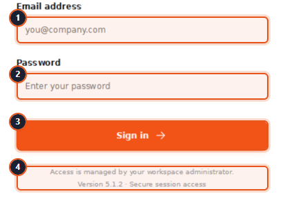

#### 1. `Email address` *(everyone)*


Your work email, exactly as the admin typed it (capitals don't matter; it is stored in lower case).


#### 2. `Password` *(everyone)*


At least 12 characters, set by the admin and changeable only by an admin (`Reset password`).

- ⚠️ After **8 wrong passwords** that email is locked for **15 minutes**. An admin can lift it early with `Release login lockouts` (Workspace settings).

#### 3. `Sign in →` *(everyone)*


Checks the password and opens the dashboard. A wrong password shows a red message above the button.


#### 4. `Version 5.1.2 · Secure session access`


The version actually running on the server (read live from `/health`). Quote it in every bug report.

- *Why it exists:* Before 5.1.1 this said "Version 5.0" even on 5.1, which confused testers.

> 🎓 **When you teach this:** Tell AL: one account per person. Every action is stored with the person's name, so sharing a login destroys the approval trail an auditor would ask for.

### 2. Dashboard on a fresh install

This is what a brand-new workspace looks like (no requests yet). It is also the cleanest view of the menu and the frame around every page.

**Where everything is:**

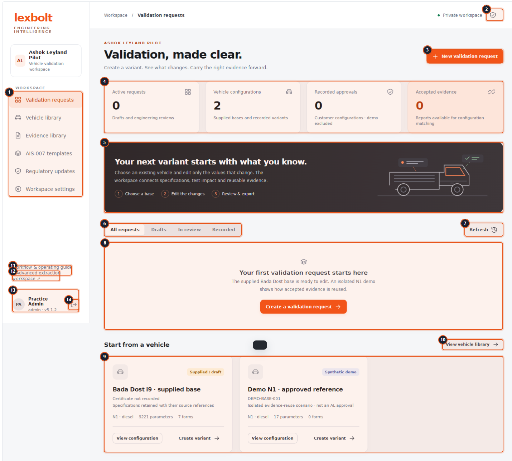

#### 1. Left menu: the six areas *(everyone)*

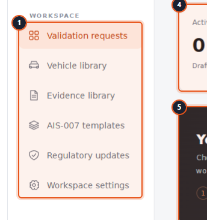

`Validation requests` (this page), `Vehicle library`, `Evidence library`, `AIS-007 templates`, `Regulatory updates` (a red number appears here when you have unread rule changes), `Workspace settings`.


#### 2. Shield button (top right) *(everyone)*

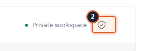

Your number of **unread** regulatory notifications. Clicking it opens Regulatory updates. "Unread" is per person.


#### 3. `New validation request` *(everyone)*


Starts a change job.

- *When you press it:* Opens the `Create a validation request` window (Section 1, screen 2).

#### 4. The four counters

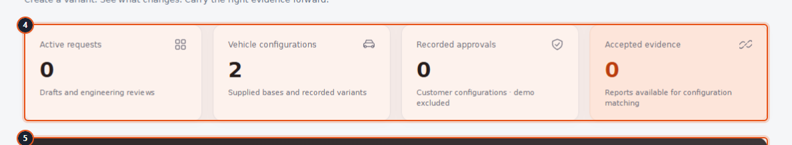

`Active requests` = requests not yet recorded (drafts + in review). `Vehicle configurations` = every vehicle in the library, demo included. `Recorded approvals` = **non-demo** vehicles with a recorded homologation (*"demo excluded"*). `Accepted evidence` = **non-demo** reports with status approved.

- *Why it exists:* The two right-hand counters ignore demo data on purpose, so a manager never mistakes practice data for real approvals. With only demo data loaded, both stay at 0.

#### 5. The dark banner (1 Choose a base · 2 Edit the changes · 3 Review & export)

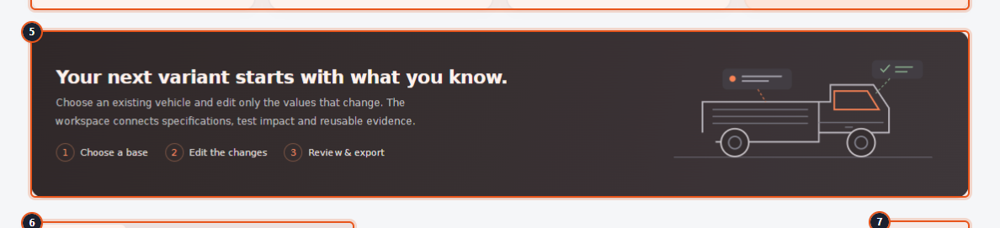

Decoration that states the three-step idea. Not clickable.


#### 6. `All requests` · `Drafts` · `In review` · `Recorded` *(everyone)*


Filters the list below by workflow state: Draft, In engineering review, Homologation recorded.


#### 7. `Refresh` *(everyone)*


Re-reads the list from the server (useful when a colleague just created something). The rest of the app refreshes on navigation.


#### 8. Empty state + `Create a validation request`


Shown only when there are no requests; the button does the same as `New validation request`.


#### 9. `Start from a vehicle` cards


The first three vehicles of the library. Each card shows a status tag, certificate (or `Certificate not recorded`), category · fuel, number of parameters and number of source PDFs. `View configuration` opens the vehicle; `Create variant →` opens the new-request window with this vehicle pre-selected.


#### 10. `View vehicle library →`


Same as clicking `Vehicle library` in the menu.


#### 11. `Workflow & operating guide ↗`


Opens the built-in static guide page in a new tab (written by the developer; shorter than this atlas).


#### 12. `Advanced extraction workspace ↗`


The old pre-5.0 screens. Out of scope: new work never goes there.


#### 13. Your name · role · version

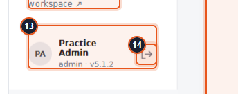

Initials, name, **role** (`admin`, `reviewer`, `engineer`) and `v5.1.2`. If a button is missing or greyed for you, check the role here first.


#### 14. Sign-out arrow

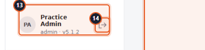

Saves anything still pending, ends the session and returns to `Welcome back`.


### 3. Dashboard with requests

The same page once requests exist. The table is sorted by **last updated**, newest first.

**Where everything is:**

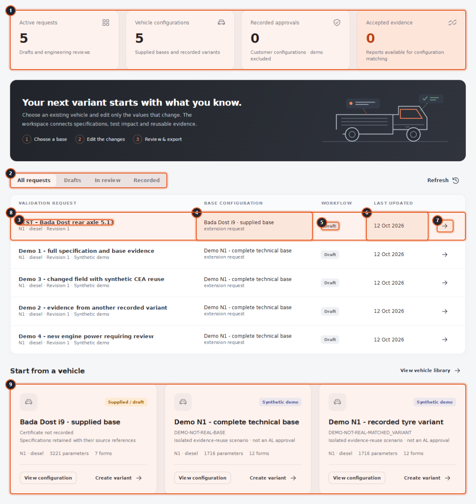

#### 1. Counters with data

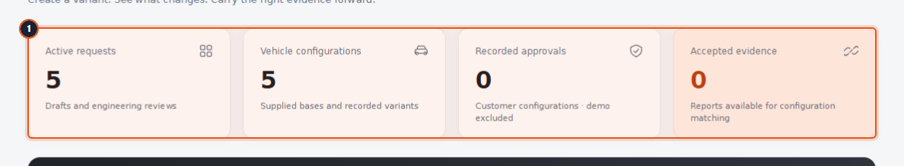

Here: active requests (the four seeded demos + practice ones), 5+ vehicle configurations, and still `0` recorded approvals / accepted evidence, because everything except Bada Dost is demo and Bada Dost has no approval.


#### 2. Workflow filter

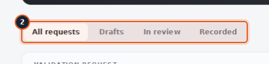

Click `Drafts` to hide finished work; `Recorded` shows approved (locked) requests.


#### 3. Request name (link)

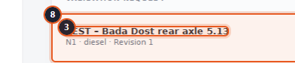

Opens the request. Under it: open regulatory actions (orange tag, if any), category · fuel, `Revision N` (goes up on every save), and `Synthetic demo` for demo-based requests.


#### 4. `BASE CONFIGURATION`


The vehicle the request was copied from, and the approval route (`extension request`, `family request`, `new request`).


#### 5. `WORKFLOW`


`Draft` (grey) → `In review` (blue) → `Homologation recorded` (green).


#### 6. `LAST UPDATED`


Date of the last change of any kind.


#### 7. → button

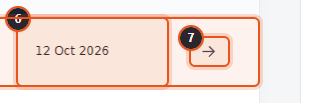

Same as clicking the name.


#### 8. One row = one change job

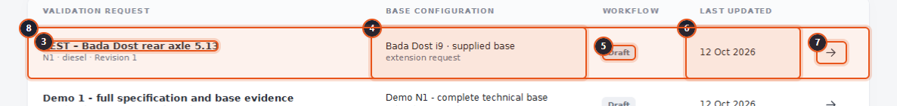

Read a row left to right: *what* (name) · *from which truck* (base) · *where it is* (workflow) · *when* (date).


#### 9. Vehicle cards

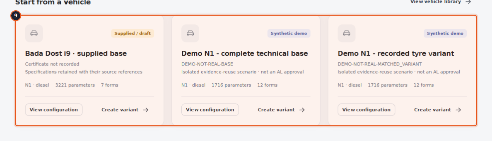

Shortcut to start a new request from one of the first three vehicles.


Some rows may carry an orange `N regulatory actions` tag and an orange banner `… regulatory actions need review` above the counters. Both come from active rule changes (Section 5).

#### 🔑 Key takeaways

- The dashboard **is** the list of validation requests.
- `Recorded approvals` and `Accepted evidence` ignore demo data, so 0 is correct until real AL data is in.
- Role (bottom-left) explains every missing or greyed button.

> 💬 **Say it like a pro:** "The two right-hand counters only count customer data, so the demo seed never inflates our approval or evidence numbers."

#### Quiz

1. The workspace has 150 accepted demo reports. What does `Accepted evidence` show?
   - a) 150
   - b) 0
   - c) 153
   <details><summary>Answer</summary>b) It counts approved reports that are **not** synthetic. All demo reports are synthetic.</details>
2. A colleague can't see `Confirm reviewed entries`. First thing to check?
   - a) Their browser
   - b) Their role under their name (bottom-left)
   - c) The app version
   <details><summary>Answer</summary>b) That button only exists for reviewer and admin.</details>

---

## Validation requests (1): create and edit

*Section 1 · 40 min*

A validation request is a **copy** of one vehicle that you change. This section covers everything on the request page except the test sorting (Section 2) and the package / approval (Section 3). The worked example is AL's own: **rear axle ratio 4.56 → 5.13 on the real Bada Dost**.

**📖 Words used here**

- **Base vehicle**: the vehicle the request is copied from. Fixed forever once created.
- **Comparison vehicle**: what your edits are measured against. Usually the base; if the base has newer **recorded extensions**, the newest one.
- **Parameter / Occurrence**: one fact (e.g. rear axle ratio) / one PDF cell where it is printed. One parameter can have several occurrences.
- **Autosave**: no save button: values save themselves about 0.65 s after you stop typing.
- **Revision**: a counter that goes up on every save; it prevents two people silently overwriting each other.
- **Calculation rule**: a reviewer-approved formula that keeps one value equal to (A × B) or (A − B).
- **Vehicle scope**: yes / no / unknown facts plus manufacture date and new/existing model; they switch conditional tests on and off.

The life of a request**Create (pick base)→**Draft**: edit, scope, review rows→`Submit for review` → **In engineering review**→reviewer `Record received homologation` → **Homologation recorded** (locked)→a new **recorded vehicle** appears in the library
Submitting is only a hand-over label: an in-review request is still fully editable. Only recording homologation locks it.


Speed on the real Bada Dost**Every save re-assesses all 92 test rows against every report in the system. With the Full Demo Seed loaded (150 extra reports), opening or saving the Bada Dost request took about 20 seconds on the practice laptop (Demo N1 requests take 1–5 s). On the server it may be faster, but warn AL that "Saving changes…" can take a while on a big truck, and **never close the tab while it says Unsaved changes**: the browser will ask before leaving.


### 1. The "Create a validation request" window

**How to get here:** `Validation requests` → orange `New validation request` (top right). Also opens from `Create variant →` on a vehicle card, `Create validation request` on a vehicle page, `Create linked request` on a locked request, and `Create linked validation request` on a regulatory impact row; those pre-fill the base.

Four fields. Only two matter for the engine: **base** and **route**.

**Where everything is:**

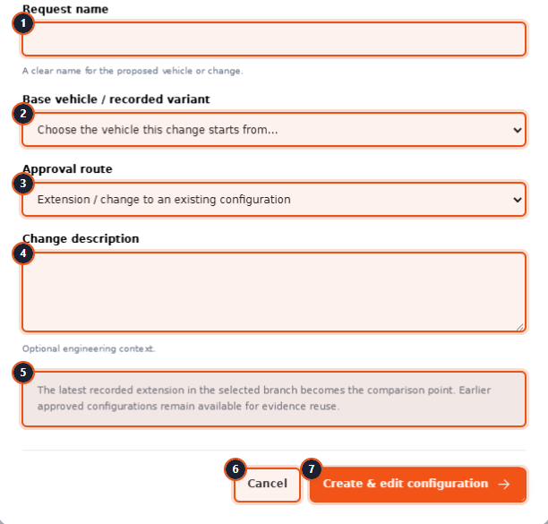

#### 1. `Request name` *(engineer +)*


Free text, for humans only. The app never reads it. Convention for practice: start with `TEST –`.


#### 2. `Base vehicle / recorded variant` *(engineer +)*


Starts **empty** (`Choose the vehicle this change starts from…`); you must pick one. Each option ends with its kind:

- `· Supplied`: data from manufacturer PDFs, no approval recorded (Bada Dost).
- `· Recorded`: a vehicle with a recorded homologation (locked, can supply evidence).
- `· Not homologated`: a base you created/imported, no approval yet.
- `· Demo`: synthetic practice vehicle.

- *When you press it:* All values, source PDFs, table list, calculation rules, scope facts and register confirmations of that vehicle are **copied** into the request. If the vehicle has newer **recorded extensions**, the newest one is copied and compared against instead (see the grey hint).
- ⚠️ It can't be changed later. A request on the wrong base must be deleted (admin) or abandoned and recreated. Before 5.1.2 this box silently picked the newest vehicle; now it forces a choice.

#### 3. `Approval route` *(engineer +)*


What kind of approval this change will need.

- `Extension / change to an existing configuration` (default): when recorded, the new vehicle **supersedes** its parent as the comparison point for later requests. ARAI suffix E01, E02…
- `Additional family variant`: a sibling. When recorded it does **not** replace the parent as comparison point. ARAI suffix F01, F02…
- `New vehicle approval`: a brand-new type.

- *Under the hood:* The route does **not** change which tests are checked or how. It matters after approval: `pilot_repository.latest()` only follows `extension` children when choosing the comparison point for the next request.

#### 4. `Change description` *(engineer +)*


Optional engineering context (e.g. "Rear axle ratio changes from 4.56 to 5.13 to improve gradeability"). Stored with the request.


#### 5. Grey hint

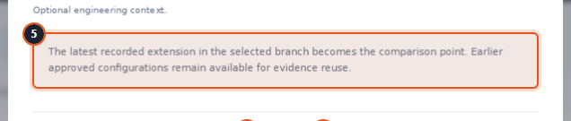

*"The latest recorded extension in the selected branch becomes the comparison point. Earlier approved configurations remain available for evidence reuse."* In plain words: you are always compared with the newest approved version, but reports from older approved versions can still be reused if they match.


#### 6. `Cancel`


Closes without creating anything.


#### 7. `Create & edit configuration →` *(engineer +)*


Creates the request (Draft, Revision 1) and opens it. Tables 8, 9, 10 and 12 (the schedules) are always added to the package even if the base didn't have them.


> 🎓 **When you teach this:** This maps exactly onto AL's ask from the 6 Oct meeting: "new request → select Bada Dost → it takes the history → it takes the base". Show them that picking the base is the only real decision here.

### 2. The request page (Edit specifications tab)

The real Bada Dost request right after creation. Header on top, three tabs, the value editor on the left, the live impact panel on the right.

**Where everything is:**

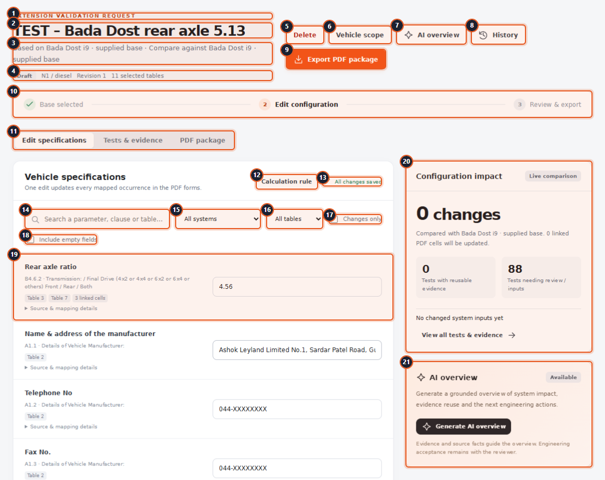

#### 1. `EXTENSION VALIDATION REQUEST`


The route you picked (`FAMILY…`, `NEW…`).


#### 2. Request name

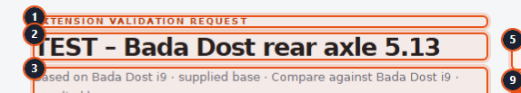

As typed. Can't be renamed in the UI.


#### 3. `Based on … · Compare against …`


**Check this line every time.** "Based on" = the vehicle values were copied from. "Compare against" = the approved state your changes are measured against (the newest recorded extension in that branch).

- ⚠️ If it names the wrong truck, the whole request is wrong. Make a new one.

#### 4. Grey tags: `Draft` · `N1 / diesel` · `Revision 1` · `11 selected tables`


Status · category / fuel (copied from the base, not editable) · save counter · number of AIS-007 forms in the package (Bada Dost: 2, 3, 4E, 5, 6, 7, 11 from AL + 8, 9, 10, 12 schedules). Demo requests also show `Synthetic demonstration`.


#### 5. `Delete` (red outline) *(admin only)*


Permanently deletes this request after a browser confirmation. Only on requests that are **not** recorded. Refused while a whole-request AI review is running.


#### 6. `Vehicle scope` *(engineer +)*


Opens the scope facts window (screen 9). Greyed out once recorded.


#### 7. `AI overview` *(engineer +)*


Starts or opens the whole-request AI review. The label shows progress (`AI overview · 12/92`) and `· Ready` when done. Details in Section 2.


#### 8. `History` *(everyone)*


Shows the approval family of the base vehicle (screen 8). Not an edit log.


#### 9. `Export PDF package` *(everyone)*


Downloads the full ZIP (same as `Download complete package` on the PDF package tab). Pending edits are saved first.


#### 10. Progress line

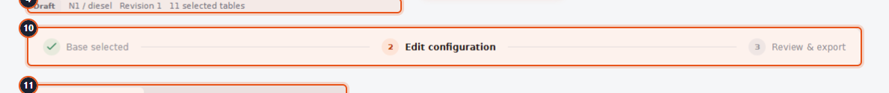

`Base selected` ✔ → `Edit configuration` → `Review & export`. It only follows the tab you are on; it doesn't track completion.


#### 11. Tabs

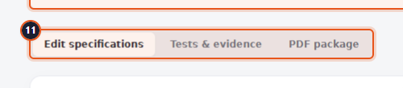

`Edit specifications` (values) · `Tests & evidence` (every test sorted, Section 2) · `PDF package` (output and approval, Section 3).


#### 12. `Calculation rule` *(reviewer / admin)*


Add a formula that keeps one value calculated from two others (screen 5).


#### 13. `✓ All changes saved`


Save state: `Unsaved changes` (you typed, waiting 0.65 s) → `Saving changes…` → `All changes saved`. On error: `Save failed · retry or reload`.


#### 14. `Search a parameter, clause or table…`


Searches each value's **label**, **context** (the section headings above it), its id, and `Table N clause` (e.g. type `B4.6` or `Table 7`). Searches only this truck's data, not standards.


#### 15. `All systems`


Filter by vehicle system: Additional specifications, Braking, Dimensions & weights, Electrical, Evidence schedule, General, Identification, Lighting, Occupant protection, Powertrain, Vehicle overall, Vehicle summary, Visibility, Wheels & tyres.


#### 16. `All tables`


Show only values printed in one table (Table 2 … Table 12).


#### 17. `Changes only`


Show only values that differ from the comparison vehicle (screen 7).


#### 18. `Include empty fields`


Empty cells are hidden by default (Bada Dost has hundreds). Tick it to fill a blank value, e.g. one a rule change now requires. A search also shows empty matches.


#### 19. A value row

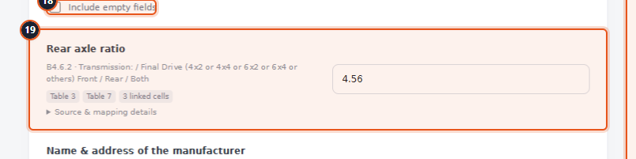

Label (bold) · clause and section context (grey) · tags (`Table 3`, `Table 7`, `3 linked cells`) · `Source & mapping details` · the value box on the right. Rows are listed 35 at a time; `Show more parameters` adds 40. The rear axle ratio is pinned to the top of the list.


#### 20. `Configuration impact` · `Live comparison`


Recalculates after every save: number of changes, how many PDF cells will be rewritten, `Tests with reusable evidence`, `Tests needing review / inputs`, then the affected systems. Here 0 / 88: Bada Dost has **no accepted reports**, so nothing can be reused yet; 88 = 92 applicable rows minus 4 not applicable.


#### 21. `AI overview` box


`Generate AI overview` starts a background review of all tests. Badge: `Available` (server key set), `Live review` (a current overview exists) or `Setup needed`.


> 🎓 **When you teach this:** Point at "Compare against" and say: "This line is your safety check. Everything the app tells you is relative to this vehicle."

### 3. Finding a value and its source

**How to get here:** Type `Rear axle ratio` in the search box, then click `Source & mapping details` under the row.

One parameter, three cells in two PDFs. This is how the app knows where to write your new value back.

**Where everything is:**

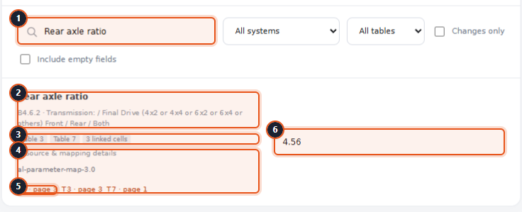

#### 1. Search box

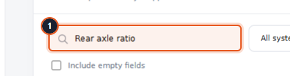

Typing filters instantly.


#### 2. `Rear axle ratio` · `B4.6.2 · Transmission: / Final Drive …`


Label, the first clause it was found under, then the section headings it sits in (its "context").


#### 3. `Table 3` `Table 7` `3 linked cells`


Printed in Tables 3 and 7, in three cells in total.

- *Why it exists:* AL pointed out in the meeting that 4.56 appears in Table 7 and in Table 3 (B5.3 reduction ratio, B6.2 final drive). One edit here rewrites every linked cell, so the forms can't contradict each other.

#### 4. `Source & mapping details`


How the value was captured (mapping kind) and one link per occurrence: `T3 · page 3`, `T7 · page 1`. Alternative supplier columns (e.g. RSB / AVTEC) stay separate values; the app never merges them into one number.


#### 5. Page link (e.g. `T3 · page 3`)


Opens the original source PDF at that page in a new tab: proof of where the number came from.


#### 6. Value box *(engineer +)*

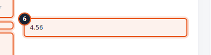

Type the new value. Long or multi-line values get a resizable text area. Values are trimmed of spaces at both ends.


### 4. After changing 4.56 → 5.13

You typed 5.13 and stopped. The app saved, re-checked all 92 tests, and redrew the impact panel.

**Where everything is:**

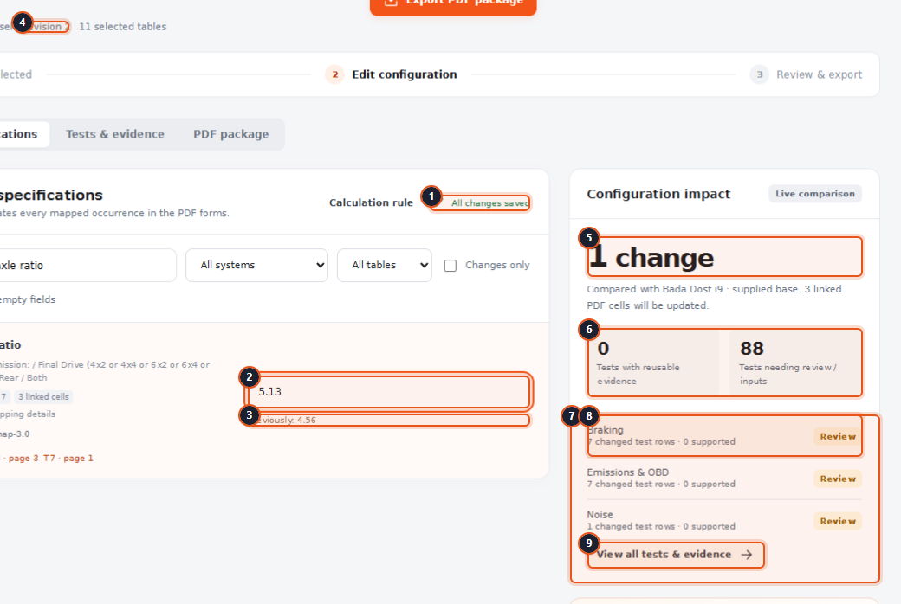

#### 1. `All changes saved`


The save went through.


#### 2. New value `5.13`


The row now has an orange left border (= changed).


#### 3. `Previously: 4.56`


The comparison vehicle's value. Type it back and the change disappears.


#### 4. `Revision 2`


The save counter went up.


#### 5. `1 change` (or more)


Number of parameters that differ from the comparison vehicle.

- *Under the hood:* Schedule-only values (Tables 8, 9, 10, 12…) are never counted as changes.

#### 6. Reusable / needing review

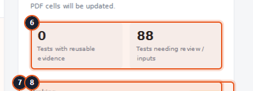

Still 0 / 88 on Bada Dost: there are no accepted reports to lose. On Demo N1 the same edit drops reusable tests from 3 to 1 (the two brake reports stop fitting).


#### 7. Affected systems

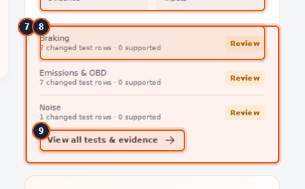

Up to six systems with `N changed test rows · N supported` and a `Covered` (green) or `Review` (amber) tag. **Click a system name** to jump to Tests & evidence filtered to it.


#### 8. e.g. `Braking · 7 changed test rows · 0 supported`


7 braking rows use the axle ratio; 0 of them still have fitting evidence.


#### 9. `View all tests & evidence →`


Switches to the Tests & evidence tab.


**Hidden consequence on Bada Dost (important for your demo):** changing the rear axle ratio automatically marks every captured **overall ratio** cell as `Calculation review`: **12 cells** on Bada Dost (1st–5th and reverse gear × the RSB and AVTEC supplier columns; e.g. 4th gear overall 4.56 = 1.0 × 4.56). Typing over them does **not** clear the flag. Each needs a reviewer `Calculation rule`, and `Record received homologation` is refused until all are calculated (*"Review and resolve dependent calculations before recording this exact approved configuration."*). The export's `01_Derived_value_review.pdf` lists them.

**Data question for AL:** the captured `1st · Overall Ratio / RSB` is 21.53, but 4.62 × 4.56 = 21.07. Either the RSB final drive differs or there is a reduction factor. Ask AL which formula they use before you demo the calculation rule.

> 🎓 **When you teach this:** Let AL type 5.13 themselves, then show the three places it lands (Table 3 twice, Table 7) in the exported PDF. That is the "type only the changed value, get every PDF back" moment they asked for.

### 5. Add a controlled calculation (reviewer)

**How to get here:** `Edit specifications` → `Calculation rule` (top of the value list). Reviewer/admin only, and only on unlocked requests.

Tells the app: "this value is always input 1 × input 2 (or input 1 − input 2), rounded like this". Only numeric values appear in the lists.

**Where everything is:**

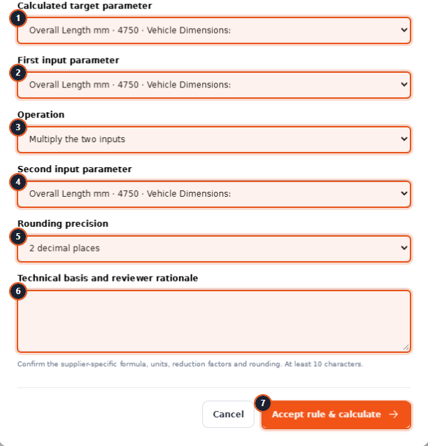

#### 1. `Calculated target parameter`


The value that will be calculated (here `1st · Overall Ratio / RSB · 21.53`). It becomes read-only.


#### 2. `First input parameter`


Here `1st · Gear Ratio / RSB · 4.62`.


#### 3. `Operation`


`Multiply the two inputs` or `First input minus second input`. Nothing else (no division, no constants).


#### 4. `Second input parameter`


Here `Rear axle ratio · 5.13`.


#### 5. `Rounding precision`


`Whole number`, `1 decimal place`, `2 decimal places` (default), `3 decimal places`.


#### 6. `Technical basis and reviewer rationale`


Why this formula is right (min. 10 characters): supplier formula, units, rounding.


#### 7. `Accept rule & calculate →`


Saves the rule, recalculates immediately, and clears any recorded engineering decisions on this request (values changed).


Rules can't chain: a target can't be an input of another rule (*"Chained formulas need controlled ordering…"*). A new rule for the same target replaces the old one. Rules are copied into requests created later from this vehicle once it is recorded.

> 🎓 **When you teach this:** Frame it as AL's own question from the meeting: "values derived from 5.13 (overall gear ratios) may also need updating". The app refuses to guess the formula; a reviewer writes it once.

### 6. A calculated value

After the rule: 4.62 × 5.13 = 23.70.

**Where everything is:**

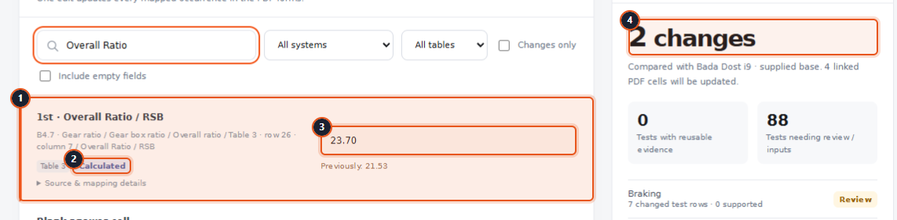

#### 1. The target row

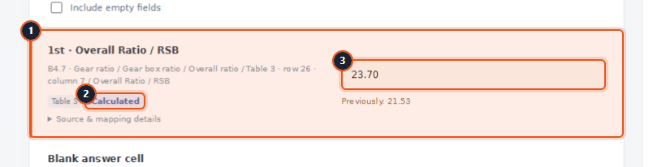

Now shows the calculated value.


#### 2. `Calculated` (blue)


Kept in step automatically. `Calculation review` (blue) instead means an input is missing or changed and needs review.


#### 3. Greyed value box

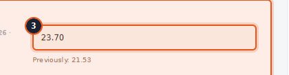

Read-only. Typing is refused (*"This value is calculated by an approved rule. Edit its inputs."*).


#### 4. Change count

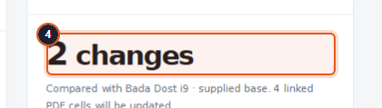

The calculated value is a change too (21.53 → 23.70), so it appears in Table 12 of the package.


### 7. "Changes only"

Tick `Changes only` to see exactly what this request changes, which is what will go into Table 12.

**Where everything is:**

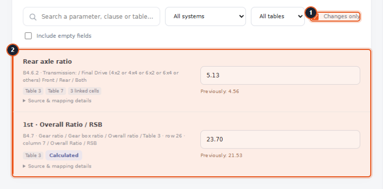

#### 1. `Changes only` ticked


Hides every unchanged value.


#### 2. The changed rows

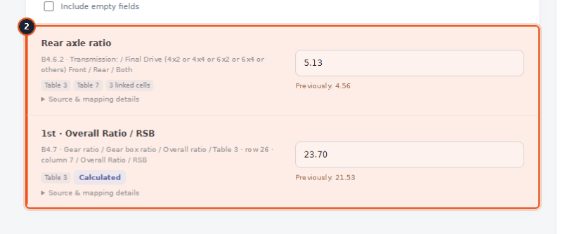

Each with `Previously: …`. This is the same list the package prints in the Table 12 continuation sheet (existing → proposed).


### 8. Configuration history

**How to get here:** Request header → `History`.

The family of the base vehicle: the base itself and every vehicle recorded from it, oldest first. It is **not** a log of edits on this request.

**Where everything is:**

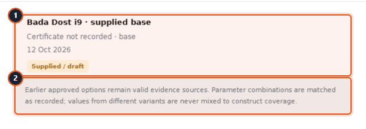

#### 1. A history item

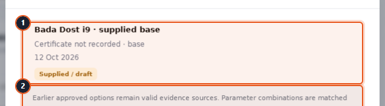

Name · certificate (or `Certificate not recorded`) · route · date · tag: `Immutable evidence source` (recorded) or `Supplied / draft`.


#### 2. Grey hint

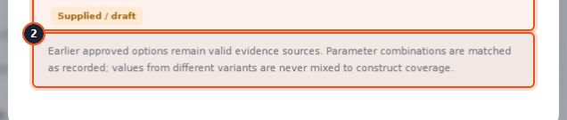

*"Earlier approved options remain valid evidence sources. Parameter combinations are matched as recorded; values from different variants are never mixed to construct coverage."* A report must match one real tested vehicle; the app never stitches together values from two vehicles to make a match.


> 🎓 **When you teach this:** AL asked for "the whole history: base, extensions and families" with E/F numbering. This window plus the Vehicle library's `Approval history` is where that lives. Be honest that the app compares against the newest **extension**; it doesn't merge 4.56 and 5.13 into one base holding both values (AL's "base should have both" wish). Each approved variant is its own vehicle.

### 9. Vehicle scope (the conditional facts)

**How to get here:** Request header → `Vehicle scope` (or the same button on the PDF package tab).

28 yes / no / unknown questions plus two implementation facts. Each fact switches one or more conditional test rows. **Set it right after your edits, before studying Tests & evidence**, because it changes the list.

**Where everything is:**

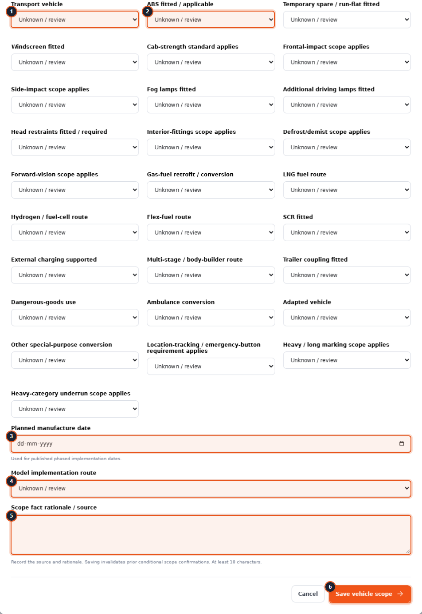

#### 1. A fact, e.g. `Transport vehicle` *(engineer +)*


Three choices for every fact:

- `Unknown / review` (default): the rows it controls stay in `Edition review` ("Confirm …. Unknown fitment / scope is retained for review").
- `Yes / applies`: the rows apply.
- `No / does not apply`: the rows become `Not applicable` ("… is recorded as not applicable / not fitted. This is an engineering scope fact, not an agency exemption.").


#### 2. `ABS fitted / applicable`


Example of a fitment fact. The full list: Transport vehicle · ABS · Temporary spare / run-flat · Windscreen · Cab-strength standard applies · Frontal-impact scope · Side-impact scope · Fog lamps · Additional driving lamps · Head restraints · Interior-fittings scope · Defrost/demist scope · Forward-vision scope · Gas-fuel retrofit · LNG · Hydrogen / fuel-cell · Flex-fuel · SCR fitted · External charging · Multi-stage / body-builder · Trailer coupling · Dangerous goods · Ambulance · Adapted vehicle · Other special-purpose conversion · Location-tracking / emergency button · Heavy / long marking · Heavy-category underrun.

- *Under the hood:* Some heavy-vehicle facts default to "excluded" for N1 when left unknown (`default_for_n1: false` in the seed), e.g. heavy-category underrun.

#### 3. `Planned manufacture date`


When this version will start being built. Compared with published implementation dates: rows that only start later become `Not applicable` (not yet in force), and regulatory updates become `upcoming` or `effective`.


#### 4. `Model implementation route`


`Unknown / review`, `New model`, `Existing model`. Many rules start earlier for new models.


#### 5. `Scope fact rationale / source`


Required (min. 10 characters): where the facts come from.

- ⚠️ Saving **clears every previous reviewer confirmation on conditional rows** and any engineering decisions on this request, so they must be re-confirmed. That's intentional: the facts behind them changed.

#### 6. `Save vehicle scope →`


Saves and recalculates. Toast: *"Vehicle scope saved. Conditional rows and evidence gates recalculated."*


### 10. Scope filled in (example)

A practice request from the complete demo base: not a transport vehicle, ABS fitted, existing model, built from 1 Dec 2026.

**Where everything is:**

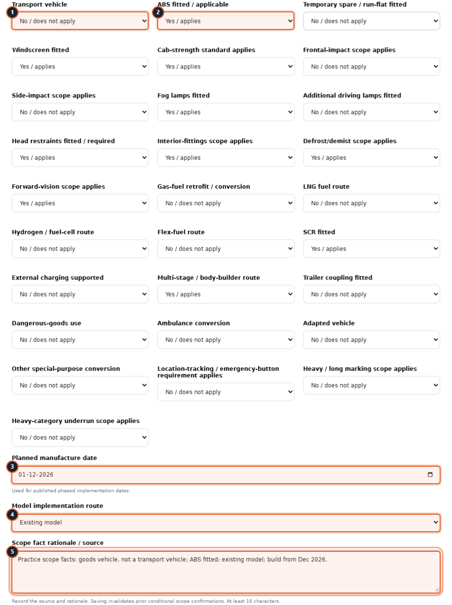

#### 1. `Transport vehicle` = No


Transport-vehicle-only rows become Not applicable.


#### 2. `ABS` = Yes


The ABS braking row applies.


#### 3. `2026-12-01`


Used for the 2027 braking transition and any rule change's effective date.


#### 4. `Existing model`


Existing-model dates apply.


#### 5. Rationale

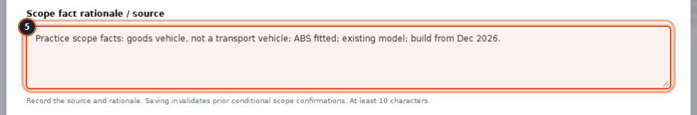

Stored with the request and shown to reviewers.


**What saving did here:** before, the request (copied from the complete demo base) had 75 reused and 17 not applicable. After saving these facts: 61 reused, 20 not applicable, 11 `Edition review`. Three more rows were excluded by the new facts, and the 11 conditional rows lost the base’s reviewer confirmations and must be confirmed again.

Scope facts are copied into the recorded vehicle at approval, so the next request from it starts with them filled in.

#### Explained two ways

**Simply:** A request is a photocopy of a truck's whole file. You change the numbers that change, and the app writes them into every form where they appear and tells you, live, how many tests are affected.

**Precisely:** A request is a deep copy of the base vehicle's fields (each with its occurrences), sources, tables, rules, register and scope profile. Every PATCH bumps the revision (optimistic locking), clears engineering decisions, re-runs calculation rules and re-runs `assess()` over the 123-row seed (92 apply to an N1 diesel), comparing values with the comparison vehicle (`latest()` along extension children).

**Putting it together:** On Bada Dost, typing 5.13 once rewrites Table 3 B4.6.2, B4.6.4 and Table 7, flags the overall ratios for a formula, and moves 7 braking rows into review. That is the "type only the changed value" flow AL asked for, with the bookkeeping their spreadsheets do by hand.

#### 🔑 Key takeaways

- The base choice is permanent; "Compare against" is your safety check.
- One edit updates every linked cell; `Changes only` = the future Table 12.
- Changing the axle ratio flags overall ratios; each needs a reviewer calculation rule before approval can be recorded.
- Set Vehicle scope before reading the test list; saving scope clears conditional confirmations.

> 💬 **Say it like a pro:** "The request is an immutable-base copy. We edit the delta, it propagates to every mapped occurrence, and derived values are blocked until a reviewer approves the formula, so nothing is silently recomputed."

> 🎓 **Teaching AL this section:** Run this section live on **Demo N1** (fast) and show the Bada Dost version only for linked cells and the PDF. Demo N1 shows reuse dropping 3 → 1, which is the "aha".

Expect AL to ask "can I change the base later?" (No: create a new request) and "why didn't the overall ratios update?" (formula must be approved; show the calculation rule).

#### ✅ Try it on the practice copy

- [ ] Create `TEST – my axle change` from **Demo N1 · approved reference**, change Rear axle ratio to 5.13, and watch reusable tests go 3 → 1.
- [ ] Open `Source & mapping details` on a Bada Dost value and open the PDF page link.
- [ ] Tick `Changes only`, then untick it.
- [ ] Open `Vehicle scope`, set ABS = No, save, and see which row becomes Not applicable.
- [ ] As reviewer: add a calculation rule on a practice request and try to type over the calculated value.

#### Quiz

1. You created a request on the wrong base. What do you do?
   - a) Change the base in the header
   - b) Create a new request on the right base (admin can delete the wrong one)
   - c) Edit every value to match the right truck
   <details><summary>Answer</summary>b) The base is copied at creation and can never be changed.</details>
2. You typed 5.13 and the header says `Unsaved changes`. You close the tab. What happens?
   - a) Nothing is lost
   - b) The browser warns you first; if you leave anyway the edit is lost
   - c) It saves on close
   <details><summary>Answer</summary>b) The page asks before unloading while edits are pending.</details>
3. After the axle change, why does `Record received homologation` fail on Bada Dost?
   - a) Because braking needs a retest
   - b) Because overall-ratio cells are flagged for calculation review
   - c) Because Bada Dost is synthetic
   <details><summary>Answer</summary>b) Any field with a derived status other than `calculated` blocks recording.</details>
4. Saving Vehicle scope also…
   - a) Locks the request
   - b) Clears confirmations on conditional rows and any engineering decisions
   - c) Sends the request to review
   <details><summary>Answer</summary>b) The facts behind those confirmations changed, so they must be redone.</details>

---

## Validation requests (2): Tests & evidence

*Section 2 · 45 min*

The heart of the app. For each of the 92 test rows that apply to an N1 diesel truck, the app decides one status and explains why. Learn to read one row and one review window, then each status in turn, using the four Demo requests that were built to show each case.

**📖 Words used here**

- **Test row / work item**: one official test or screening topic from the Regulatory seed (123 India rows; 92 apply to N1 diesel).
- **Mapped parameters**: the values a test depends on, found by keyword. `1 changed / 14 mapped` = 14 values matter, 1 changed.
- **Coverage**: the exact values of the tested vehicle, frozen in the report.
- **Register confirmation**: a reviewer saying "edition X applies to this request for this test".
- **Eligible**: a report passes every reuse check for this request.
- **CEA**: an accepted range that lets a report cover small differences.

How the app picks a status: first match wins**The order matters. It explains surprises like "I changed the axle ratio but the braking row says Inputs needed, not Engineering review".
- **Not applicable**: scope fact = No, reviewer exclusion, or not yet in force on the planned build date.
- **Retest recorded**: a reviewer decision says retest.
- **Engineering review**: a reviewer decision says review, **or** an N1 request declares GVW above 3,500 kg.
- **Edition review**: a scope fact this row depends on is unknown.
- **Evidence reused**: at least one report is eligible.
- **Inputs needed**: a required input is missing, unresolved or conflicting.
- **Edition review**: no reviewer confirmation of edition/applicability for the current seed.
- **Engineering review**: a mapped value changed and nothing covers it.
- **Evidence missing**: everything else.
Then, on top: if an **active rule change** applies (and isn't upcoming) and scope or the new edition isn't confirmed, the row is forced to **Edition review** with a sentence naming what is left. Try it in the Status ladder lab below. Code: `pilot_assessment.assess()`.


Why Bada Dost shows zero reuse today**On the real truck: 62 rows `Inputs needed`, 26 `Edition review`, 4 `Not applicable`, 0 reused. No real AL reports are recorded, Bada Dost has no recorded homologation (so its reports could never be accepted), and many required inputs are blank on the 7 supplied forms. That is the honest starting state of the pilot, not a bug.


### 1. The Tests & evidence tab

**How to get here:** Request page → `Tests & evidence`. Shown here on the real Bada Dost request after the 5.13 edit.

Three summary tags, a toolbar, a grey reminder, then one row per test.

**Where everything is:**

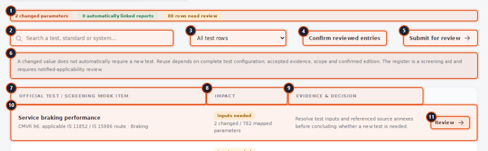

#### 1. `N changed parameters` · `N automatically linked reports` · `N rows need review`


Orange: changed values. Green: rows reusing a report. Amber: rows that are neither reused nor not applicable (the "blockers").


#### 2. `Search a test, standard or system…`


Filters by test title, standard text (e.g. `IS 11852`, `CMVR 96`) or system (e.g. `Braking`). Clicking a system in the impact panel fills this for you.

- ⚠️ The search text **stays** when you open another request (app quirk). If a list looks oddly short, clear this box.

#### 3. `Filter test status`


Options: `All test rows`, `Evidence reused`, `Engineering review`, `Inputs needed`, `Evidence missing`, `Edition review`, `Retest recorded`. (`Not applicable` has no filter entry; use All + search.)


#### 4. `Confirm reviewed entries` *(reviewer / admin)*


Batch-confirm editions for the rows **currently shown** (filter/search first). Reviewer/admin only; hidden for engineers; greyed when locked.


#### 5. `Submit for review →` *(engineer +)*


Hand the request to a reviewer (Section 3). Greyed when locked.


#### 6. Grey reminder

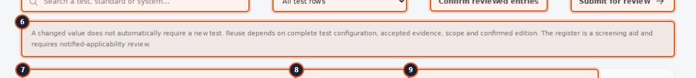

*"A changed value does not automatically require a new test…"* The screening register is an aid; notified applicability needs human review.


#### 7. `OFFICIAL TEST / SCREENING WORK ITEM`


Test name (bold), an orange `Regulatory change` tag if a rule change touches it, then grey: standard / law · system.


#### 8. `IMPACT`


Status tag, then `N changed / N mapped parameters`.


#### 9. `EVIDENCE & DECISION`


The reason sentence, plus a link pill to the reused report (`reference · vehicle`) when there is one.


#### 10. A row

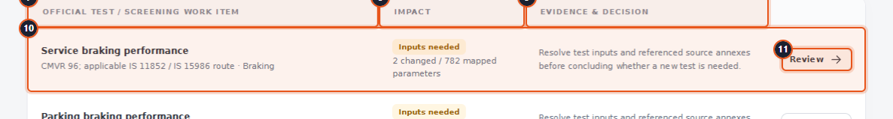

One test. Read: name → status → reason.


#### 11. `Review →` *(everyone)*


Opens the review window for this row (next screens).


### 2. Demo 1: a complete truck, everything reused

**How to get here:** Open `Demo 1 - full specification and base evidence` → `Tests & evidence`.

What a healthy approved truck looks like: no changes, every applicable test linked to an accepted report: 75 reused, 17 not applicable, 0 blockers.

**Where everything is:**

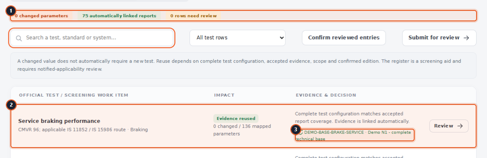

#### 1. `0 changed` · `75 automatically linked` · `0 rows need review`


The target state for real AL trucks once their reports are in.


#### 2. A reused row

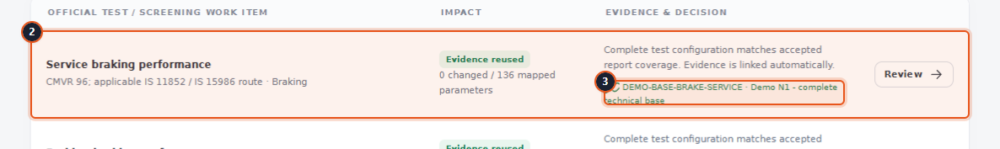

`Evidence reused` + `0 changed / N mapped parameters`.


#### 3. Report pill

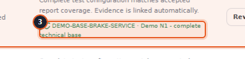

`DEMO-BASE-… · Demo N1 - complete technical base`. Click to open the report PDF.


### 3. Review window: Evidence reused (exact)

Service braking on Demo 1. Every mapped value equals the report's recorded coverage.

**Where everything is:**

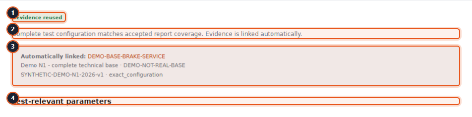

#### 1. Status tag


`Evidence reused` (green).


#### 2. Reason sentence


*"Complete test configuration matches accepted report coverage. Evidence is linked automatically."*


#### 3. `Automatically linked: `


Only when reused: the report (click to open its PDF), the tested vehicle and its certificate, the edition, and the match kind: `exact_configuration` or `accepted_cea`.


#### 4. `Test-relevant parameters`


Every mapped parameter with its current value (`Not recorded` if empty). On the complete demo truck service braking maps 100+ values, so this list is long; scroll.


#### 5. `Evidence comparison across recorded vehicles`

*(Not in the picture: this part is further down the same window. Scroll down in the app to see it.)*

Every report for this test, **from any vehicle**, tagged `Eligible` or `Not eligible` with every reason. This is the full reuse check made visible. Typical reasons: `Source vehicle has no recorded homologation` · `Demo evidence is isolated from customer vehicles` · `Report has not been accepted or was withdrawn` · `Passing result not established` · `Report bytes missing or hash mismatch` · `Expired or validity unconfirmed` · `Target test edition and applicability need confirmation` · `Test edition does not match` · `Vehicle category outside report scope` · `N test parameter(s) outside recorded coverage` · `Incomplete test inputs / unresolved source references` · `Target has fewer parameters than the recorded test scope` · regulatory reasons.


#### 6. `Regulatory basis`

*(Not in the picture: this part is further down the same window. Scroll down in the app to see it.)*

Three lines: the law (e.g. `CMVR Rule 96`) · scope level (`vehicle` or `component…`) and notification status (`review_required` = the catalogue isn't certain of the current edition/clause) · the AIS-007 tables this test touches. Then the applicability sentence (why the row applies or not).


#### 7. `Acceptance and evidence`

*(Not in the picture: this part is further down the same window. Scroll down in the app to see it.)*

What a report must show to count. The app stores **no pass/fail limits** ("No universal pass threshold is seeded"); the checklist names the conditions: verified file fingerprint, recorded source approval + certificate, pass + reviewer acceptance, same category / edition / route / complete parameters / supplier scope, validity and CEA when values differ.


#### 8. `Source and criteria`

*(Not in the picture: this part is further down the same window. Scroll down in the app to see it.)*

The reference document the catalogue used, with `Official reference ↗`, and the clause locator (often "to be confirmed").


#### 9. `Confirm edition & applicability` *(reviewer / admin)*

*(Not in the picture: this part is further down the same window. Scroll down in the app to see it.)*

Record the exact edition for this row, or exclude it with a basis. Same as one row of `Confirm reviewed entries`.


#### 10. `Record engineering decision` *(reviewer / admin)*

*(Not in the picture: this part is further down the same window. Scroll down in the app to see it.)*

Force `Engineering / CEA review required`, `New verification / retest required`, or clear a previous decision.


#### 11. `AI overview of this test` *(engineer +)*

*(Not in the picture: this part is further down the same window. Scroll down in the app to see it.)*

Queues an AI explanation of just this row (its own queue, can run alongside a whole-request review). Becomes `Read AI overview of this test` when ready.


### 4. Evidence from another recorded vehicle (Demo 2)

**How to get here:** Open `Demo 2 - evidence from another recorded variant` → `Tests & evidence` → `Review →` on service braking.

Demo 2 changes the tyres (5 values) on the complete base. Its own base reports no longer fit some tests, but the **recorded tyre variant** was tested with exactly these tyres, so the app links that vehicle's report instead: 33 links come from the other vehicle.

**Where everything is:**

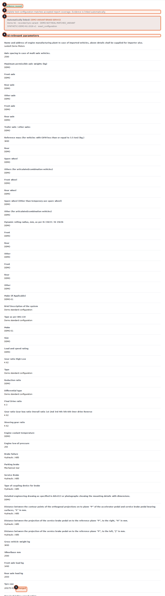

#### 1. Status tag

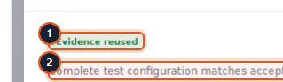

`Evidence reused`.


#### 2. Reason sentence


Same sentence. The difference is in the linked box: the report belongs to `Demo N1 - recorded tyre variant`, with its own certificate.


#### 3. `Automatically linked: `


Only when reused: the report (click to open its PDF), the tested vehicle and its certificate, the edition, and the match kind: `exact_configuration` or `accepted_cea`.


#### 4. `Test-relevant parameters`


Every mapped parameter with its current value (`Not recorded` if empty). On the complete demo truck service braking maps 100+ values, so this list is long; scroll.


#### 5. `Changed` (orange)


Marks the mapped values that differ from the comparison vehicle.


#### 6. `Evidence comparison across recorded vehicles`

*(Not in the picture: this part is further down the same window. Scroll down in the app to see it.)*

Every report for this test, **from any vehicle**, tagged `Eligible` or `Not eligible` with every reason. This is the full reuse check made visible. Typical reasons: `Source vehicle has no recorded homologation` · `Demo evidence is isolated from customer vehicles` · `Report has not been accepted or was withdrawn` · `Passing result not established` · `Report bytes missing or hash mismatch` · `Expired or validity unconfirmed` · `Target test edition and applicability need confirmation` · `Test edition does not match` · `Vehicle category outside report scope` · `N test parameter(s) outside recorded coverage` · `Incomplete test inputs / unresolved source references` · `Target has fewer parameters than the recorded test scope` · regulatory reasons.


#### 7. `Regulatory basis`

*(Not in the picture: this part is further down the same window. Scroll down in the app to see it.)*

Three lines: the law (e.g. `CMVR Rule 96`) · scope level (`vehicle` or `component…`) and notification status (`review_required` = the catalogue isn't certain of the current edition/clause) · the AIS-007 tables this test touches. Then the applicability sentence (why the row applies or not).


#### 8. `Acceptance and evidence`

*(Not in the picture: this part is further down the same window. Scroll down in the app to see it.)*

What a report must show to count. The app stores **no pass/fail limits** ("No universal pass threshold is seeded"); the checklist names the conditions: verified file fingerprint, recorded source approval + certificate, pass + reviewer acceptance, same category / edition / route / complete parameters / supplier scope, validity and CEA when values differ.


#### 9. `Source and criteria`

*(Not in the picture: this part is further down the same window. Scroll down in the app to see it.)*

The reference document the catalogue used, with `Official reference ↗`, and the clause locator (often "to be confirmed").


#### 10. `Confirm edition & applicability` *(reviewer / admin)*

*(Not in the picture: this part is further down the same window. Scroll down in the app to see it.)*

Record the exact edition for this row, or exclude it with a basis. Same as one row of `Confirm reviewed entries`.


#### 11. `Record engineering decision` *(reviewer / admin)*

*(Not in the picture: this part is further down the same window. Scroll down in the app to see it.)*

Force `Engineering / CEA review required`, `New verification / retest required`, or clear a previous decision.


#### 12. `AI overview of this test` *(engineer +)*

*(Not in the picture: this part is further down the same window. Scroll down in the app to see it.)*

Queues an AI explanation of just this row (its own queue, can run alongside a whole-request review). Becomes `Read AI overview of this test` when ready.


This is the strongest selling point for AL: proof is matched by **configuration**, not by family tree. Any recorded vehicle with the identical setup can lend its report. Table 9 of the package names the source vehicle and certificate.

### 5. Reuse through a CEA range

**How to get here:** Built in Section 4: report `TEST-BRAKE-01` (tested at 5.13) got a CEA range 4.5–5.2; a new Demo N1 request at 4.80 now reuses it.

A changed value can still reuse a report if a reviewer recorded a range for it.

**Where everything is:**


#### 1. `Evidence reused`


Even though 4.80 ≠ 5.13.


#### 2. Linked box, match `accepted_cea`


The reason reads *"All changed parameters are inside a reviewer-accepted CEA range. Evidence is linked automatically."*


#### 3. Comparison list


The original `DEMO-in-brake-service` (tested at 4.56, no range) is `Not eligible`: *"1 test parameter(s) outside recorded coverage"*. `TEST-BRAKE-01` is `Eligible`.


A CEA only counts if: the report is accepted, the range was recorded by a reviewer with a source and a basis, the CEA edition equals the request's confirmed edition, and the value is a plain number inside [min, max]. The seeded Demo 3 request shows the same with a headlamp-height change 550 → 600 mm under a fictional 500–650 mm range (12 links).

### 6. Demo 4: Engineering review rows

**How to get here:** Open `Demo 4 - new engine power requiring review` → `Tests & evidence` → filter `Engineering review`.

Demo 4 raises engine power 59 → 65 kW (3 changed values). 19 rows that depend on power lose their exact match: `Engineering review`. 55 unaffected rows still reuse their reports.

**Where everything is:**


#### 1. Filter = `Engineering review`


Only those rows.


#### 2. A row


`N changed / N mapped` > 0 and the reason *"Test-relevant values changed and no accepted evidence covers the proposed configuration. Check the applicable CEA / worst-case criteria; a new test is not presumed from a field change alone."*


### 7. Review window: Engineering review

The comparison list shows why the base report no longer fits: the changed values are outside its recorded coverage.

**Where everything is:**


#### 1. Status tag


`Engineering review` (orange).


#### 2. Reason sentence


"Test-relevant values changed and no accepted evidence covers…". A person must decide: CEA / worst case covers it, or a new test.


#### 3. `Test-relevant parameters`


Every mapped parameter with its current value (`Not recorded` if empty). On the complete demo truck service braking maps 100+ values, so this list is long; scroll.


#### 4. `Changed` (orange)


Marks the mapped values that differ from the comparison vehicle.


#### 5. `Evidence comparison across recorded vehicles`

*(Not in the picture: this part is further down the same window. Scroll down in the app to see it.)*

Every report for this test, **from any vehicle**, tagged `Eligible` or `Not eligible` with every reason. This is the full reuse check made visible. Typical reasons: `Source vehicle has no recorded homologation` · `Demo evidence is isolated from customer vehicles` · `Report has not been accepted or was withdrawn` · `Passing result not established` · `Report bytes missing or hash mismatch` · `Expired or validity unconfirmed` · `Target test edition and applicability need confirmation` · `Test edition does not match` · `Vehicle category outside report scope` · `N test parameter(s) outside recorded coverage` · `Incomplete test inputs / unresolved source references` · `Target has fewer parameters than the recorded test scope` · regulatory reasons.


#### 6. `Regulatory basis`

*(Not in the picture: this part is further down the same window. Scroll down in the app to see it.)*

Three lines: the law (e.g. `CMVR Rule 96`) · scope level (`vehicle` or `component…`) and notification status (`review_required` = the catalogue isn't certain of the current edition/clause) · the AIS-007 tables this test touches. Then the applicability sentence (why the row applies or not).


#### 7. `Acceptance and evidence`

*(Not in the picture: this part is further down the same window. Scroll down in the app to see it.)*

What a report must show to count. The app stores **no pass/fail limits** ("No universal pass threshold is seeded"); the checklist names the conditions: verified file fingerprint, recorded source approval + certificate, pass + reviewer acceptance, same category / edition / route / complete parameters / supplier scope, validity and CEA when values differ.


#### 8. `Source and criteria`

*(Not in the picture: this part is further down the same window. Scroll down in the app to see it.)*

The reference document the catalogue used, with `Official reference ↗`, and the clause locator (often "to be confirmed").


#### 9. `Confirm edition & applicability` *(reviewer / admin)*

*(Not in the picture: this part is further down the same window. Scroll down in the app to see it.)*

Record the exact edition for this row, or exclude it with a basis. Same as one row of `Confirm reviewed entries`.


#### 10. `Record engineering decision` *(reviewer / admin)*

*(Not in the picture: this part is further down the same window. Scroll down in the app to see it.)*

Force `Engineering / CEA review required`, `New verification / retest required`, or clear a previous decision.


#### 11. `AI overview of this test` *(engineer +)*

*(Not in the picture: this part is further down the same window. Scroll down in the app to see it.)*

Queues an AI explanation of just this row (its own queue, can run alongside a whole-request review). Becomes `Read AI overview of this test` when ready.


### 8. Review window: Retest recorded

In Demo 4 a reviewer recorded a retest for the Type I emissions row. The reason sentence **is** the reviewer's note.

**Where everything is:**


#### 1. Status tag


`Retest recorded` (red).


#### 2. Reason sentence


The reviewer's decision note.


#### 3. `Test-relevant parameters`


Every mapped parameter with its current value (`Not recorded` if empty). On the complete demo truck service braking maps 100+ values, so this list is long; scroll.


#### 4. `Changed` (orange)


Marks the mapped values that differ from the comparison vehicle.


#### 5. `Evidence comparison across recorded vehicles`


Every report for this test, **from any vehicle**, tagged `Eligible` or `Not eligible` with every reason. This is the full reuse check made visible. Typical reasons: `Source vehicle has no recorded homologation` · `Demo evidence is isolated from customer vehicles` · `Report has not been accepted or was withdrawn` · `Passing result not established` · `Report bytes missing or hash mismatch` · `Expired or validity unconfirmed` · `Target test edition and applicability need confirmation` · `Test edition does not match` · `Vehicle category outside report scope` · `N test parameter(s) outside recorded coverage` · `Incomplete test inputs / unresolved source references` · `Target has fewer parameters than the recorded test scope` · regulatory reasons.


#### 6. `Regulatory basis`


Three lines: the law (e.g. `CMVR Rule 96`) · scope level (`vehicle` or `component…`) and notification status (`review_required` = the catalogue isn't certain of the current edition/clause) · the AIS-007 tables this test touches. Then the applicability sentence (why the row applies or not).


#### 7. `Acceptance and evidence`


What a report must show to count. The app stores **no pass/fail limits** ("No universal pass threshold is seeded"); the checklist names the conditions: verified file fingerprint, recorded source approval + certificate, pass + reviewer acceptance, same category / edition / route / complete parameters / supplier scope, validity and CEA when values differ.


#### 8. `Source and criteria`


The reference document the catalogue used, with `Official reference ↗`, and the clause locator (often "to be confirmed").


#### 9. `Confirm edition & applicability` *(reviewer / admin)*


Record the exact edition for this row, or exclude it with a basis. Same as one row of `Confirm reviewed entries`.


#### 10. `Record engineering decision` *(reviewer / admin)*


Force `Engineering / CEA review required`, `New verification / retest required`, or clear a previous decision.


#### 11. `AI overview of this test` *(engineer +)*


Queues an AI explanation of just this row (its own queue, can run alongside a whole-request review). Becomes `Read AI overview of this test` when ready.


Decisions are tied to the exact configuration. Edit any value, save scope or add a calculation rule, and every decision on the request is cleared automatically.

### 9. Review window: Not applicable

Excluded rows still open, so you can check the exclusion reason (here from the seeded scope / reviewer confirmation).

**Where everything is:**


#### 1. Status tag


`Not applicable` (grey).


#### 2. Reason sentence


Why it's excluded: a scope fact set to No, a reviewer's justified exclusion, or "before the published implementation date".


#### 3. `Test-relevant parameters`


Every mapped parameter with its current value (`Not recorded` if empty). On the complete demo truck service braking maps 100+ values, so this list is long; scroll.


#### 4. `Evidence comparison across recorded vehicles`

*(Not in the picture: this part is further down the same window. Scroll down in the app to see it.)*

Every report for this test, **from any vehicle**, tagged `Eligible` or `Not eligible` with every reason. This is the full reuse check made visible. Typical reasons: `Source vehicle has no recorded homologation` · `Demo evidence is isolated from customer vehicles` · `Report has not been accepted or was withdrawn` · `Passing result not established` · `Report bytes missing or hash mismatch` · `Expired or validity unconfirmed` · `Target test edition and applicability need confirmation` · `Test edition does not match` · `Vehicle category outside report scope` · `N test parameter(s) outside recorded coverage` · `Incomplete test inputs / unresolved source references` · `Target has fewer parameters than the recorded test scope` · regulatory reasons.


#### 5. `Regulatory basis`

*(Not in the picture: this part is further down the same window. Scroll down in the app to see it.)*

Three lines: the law (e.g. `CMVR Rule 96`) · scope level (`vehicle` or `component…`) and notification status (`review_required` = the catalogue isn't certain of the current edition/clause) · the AIS-007 tables this test touches. Then the applicability sentence (why the row applies or not).


#### 6. `Acceptance and evidence`

*(Not in the picture: this part is further down the same window. Scroll down in the app to see it.)*

What a report must show to count. The app stores **no pass/fail limits** ("No universal pass threshold is seeded"); the checklist names the conditions: verified file fingerprint, recorded source approval + certificate, pass + reviewer acceptance, same category / edition / route / complete parameters / supplier scope, validity and CEA when values differ.


#### 7. `Source and criteria`

*(Not in the picture: this part is further down the same window. Scroll down in the app to see it.)*

The reference document the catalogue used, with `Official reference ↗`, and the clause locator (often "to be confirmed").


#### 8. `Confirm edition & applicability` *(reviewer / admin)*

*(Not in the picture: this part is further down the same window. Scroll down in the app to see it.)*

Record the exact edition for this row, or exclude it with a basis. Same as one row of `Confirm reviewed entries`.


#### 9. `Record engineering decision` *(reviewer / admin)*

*(Not in the picture: this part is further down the same window. Scroll down in the app to see it.)*

Force `Engineering / CEA review required`, `New verification / retest required`, or clear a previous decision.


#### 10. `AI overview of this test` *(engineer +)*

*(Not in the picture: this part is further down the same window. Scroll down in the app to see it.)*

Queues an AI explanation of just this row (its own queue, can run alongside a whole-request review). Becomes `Read AI overview of this test` when ready.


### 10. Edition review rows

**How to get here:** A practice request from the complete demo base, after saving Vehicle scope (which clears conditional confirmations).

Rows the reviewer must (re)confirm.

**Where everything is:**


#### 1. Filter = `Edition review`


Typical reasons: "Confirm applicability, notified edition and test route for the current regulatory seed." or "Confirm . Unknown fitment / scope is retained for review." or a regulatory-update sentence.


#### 2. A row


Blue tag. Not a verdict: a stop sign before reuse.


#### 3. `Confirm reviewed entries` *(reviewer / admin)*


Batch-confirm exactly these rows.


### 11. Review window: Edition review

The reviewer buttons at the bottom are the way out of this status.

**Where everything is:**


#### 1. Status tag


`Edition review` (blue).


#### 2. Reason sentence


Names exactly what is unconfirmed.


#### 3. `Test-relevant parameters`


Every mapped parameter with its current value (`Not recorded` if empty). On the complete demo truck service braking maps 100+ values, so this list is long; scroll.


#### 4. `Evidence comparison across recorded vehicles`

*(Not in the picture: this part is further down the same window. Scroll down in the app to see it.)*

Every report for this test, **from any vehicle**, tagged `Eligible` or `Not eligible` with every reason. This is the full reuse check made visible. Typical reasons: `Source vehicle has no recorded homologation` · `Demo evidence is isolated from customer vehicles` · `Report has not been accepted or was withdrawn` · `Passing result not established` · `Report bytes missing or hash mismatch` · `Expired or validity unconfirmed` · `Target test edition and applicability need confirmation` · `Test edition does not match` · `Vehicle category outside report scope` · `N test parameter(s) outside recorded coverage` · `Incomplete test inputs / unresolved source references` · `Target has fewer parameters than the recorded test scope` · regulatory reasons.


#### 5. `Regulatory basis`

*(Not in the picture: this part is further down the same window. Scroll down in the app to see it.)*

Three lines: the law (e.g. `CMVR Rule 96`) · scope level (`vehicle` or `component…`) and notification status (`review_required` = the catalogue isn't certain of the current edition/clause) · the AIS-007 tables this test touches. Then the applicability sentence (why the row applies or not).


#### 6. `Acceptance and evidence`

*(Not in the picture: this part is further down the same window. Scroll down in the app to see it.)*

What a report must show to count. The app stores **no pass/fail limits** ("No universal pass threshold is seeded"); the checklist names the conditions: verified file fingerprint, recorded source approval + certificate, pass + reviewer acceptance, same category / edition / route / complete parameters / supplier scope, validity and CEA when values differ.


#### 7. `Source and criteria`

*(Not in the picture: this part is further down the same window. Scroll down in the app to see it.)*

The reference document the catalogue used, with `Official reference ↗`, and the clause locator (often "to be confirmed").


#### 8. `Confirm edition & applicability` *(reviewer / admin)*

*(Not in the picture: this part is further down the same window. Scroll down in the app to see it.)*

Record the exact edition for this row, or exclude it with a basis. Same as one row of `Confirm reviewed entries`.


#### 9. `Record engineering decision` *(reviewer / admin)*

*(Not in the picture: this part is further down the same window. Scroll down in the app to see it.)*

Force `Engineering / CEA review required`, `New verification / retest required`, or clear a previous decision.


#### 10. `AI overview of this test` *(engineer +)*

*(Not in the picture: this part is further down the same window. Scroll down in the app to see it.)*

Queues an AI explanation of just this row (its own queue, can run alongside a whole-request review). Becomes `Read AI overview of this test` when ready.


### 12. Review window: Inputs needed (real Bada Dost)

A Bada Dost row after the 5.13 edit. Missing inputs are checked **before** "values changed", so even braking shows Inputs needed here.

**Where everything is:**


#### 1. Status tag


`Inputs needed` (amber).


#### 2. `Information needed`


Only for `Inputs needed`: the exact missing inputs, e.g. "Rear axle ratio (value or referenced annex required)" or "(conflicting sources)".


#### 3. `Test-relevant parameters`


Every mapped parameter with its current value (`Not recorded` if empty). On the complete demo truck service braking maps 100+ values, so this list is long; scroll.


#### 4. `Evidence comparison across recorded vehicles`

*(Not in the picture: this part is further down the same window. Scroll down in the app to see it.)*

Every report for this test, **from any vehicle**, tagged `Eligible` or `Not eligible` with every reason. This is the full reuse check made visible. Typical reasons: `Source vehicle has no recorded homologation` · `Demo evidence is isolated from customer vehicles` · `Report has not been accepted or was withdrawn` · `Passing result not established` · `Report bytes missing or hash mismatch` · `Expired or validity unconfirmed` · `Target test edition and applicability need confirmation` · `Test edition does not match` · `Vehicle category outside report scope` · `N test parameter(s) outside recorded coverage` · `Incomplete test inputs / unresolved source references` · `Target has fewer parameters than the recorded test scope` · regulatory reasons.


#### 5. `Regulatory basis`

*(Not in the picture: this part is further down the same window. Scroll down in the app to see it.)*

Three lines: the law (e.g. `CMVR Rule 96`) · scope level (`vehicle` or `component…`) and notification status (`review_required` = the catalogue isn't certain of the current edition/clause) · the AIS-007 tables this test touches. Then the applicability sentence (why the row applies or not).


#### 6. `Acceptance and evidence`

*(Not in the picture: this part is further down the same window. Scroll down in the app to see it.)*

What a report must show to count. The app stores **no pass/fail limits** ("No universal pass threshold is seeded"); the checklist names the conditions: verified file fingerprint, recorded source approval + certificate, pass + reviewer acceptance, same category / edition / route / complete parameters / supplier scope, validity and CEA when values differ.


#### 7. `Source and criteria`

*(Not in the picture: this part is further down the same window. Scroll down in the app to see it.)*

The reference document the catalogue used, with `Official reference ↗`, and the clause locator (often "to be confirmed").


#### 8. Buttons

*(Not in the picture: this part is further down the same window. Scroll down in the app to see it.)*

As admin: `Confirm edition & applicability`, `Record engineering decision`, `AI overview of this test`.


Fix: read `Information needed`, search those words in `Edit specifications` (tick `Include empty fields`), fill them. A value counts as **unresolved** if it is empty, `-` or `--`, has a source conflict, is a derived value not yet calculated (the 12 flagged overall ratios!), or contains the words refer / annexure / enclosure / appendix (e.g. "Refer Annexure 3"). So on Bada Dost the axle change itself creates input gaps for braking and powertrain rows until the overall-ratio formulas are approved.

#### Explained two ways

**Simply:** For each official test the app asks: does an approved report for exactly this truck already exist? If yes, reuse it. If no, it tells you what's stopping it: missing data, an unconfirmed rule version, or a changed value someone must judge.

**Precisely:** `assess()` evaluates 92 applicable rows with a fixed precedence (scope → decision → classification → scope-unknown → eligible evidence → input gaps → register confirmation → changed mapped params → missing), then overlays active regulatory updates. Eligibility (`compare_report`) is an AND of ~15 checks: source homologated, synthetic isolation, accepted, pass, file hash, validity, confirmed edition equal to report edition, category, mapping version, every mapped value equal or inside an accepted CEA, no input gaps, no fewer parameters than the report covered.

**Putting it together:** On Demo N1, 4.56 → 5.13 drops the two brake reports (coverage 4.56) but keeps the horn report (it doesn't map the axle ratio). On the real Bada Dost nothing is reused yet because no AL report exists. Once AL's reports are uploaded on a recorded Bada Dost, the same edit will show exactly which reports survive.

#### 🔑 Key takeaways

- First match wins: Inputs needed outranks Engineering review.
- Reuse = one accepted report on a recorded vehicle whose recorded values equal yours (or sit in a CEA range), under the same confirmed edition.
- Evidence can come from any recorded vehicle with the same setup (Demo 2).
- Decisions vanish when values change, on purpose.

> 💬 **Say it like a pro:** "Reuse is configuration-matched, not family-matched: any homologated variant whose recorded test parameters equal ours can lend its report, provided the edition we confirmed equals the report's edition."

> 🎓 **Teaching AL this section:** Teach statuses with Demo 1 → 2 → 3 → 4 in order: all reused → reused from another vehicle → reused through a range → review / retest. Then show Bada Dost as "where you are today".

Use the ladder lab to answer "why does it say X?" questions live.

#### ✅ Try it on the practice copy

- [ ] Open Demo 1, filter `Evidence reused`, open one Review window and find the linked report.
- [ ] Open Demo 2 and find a row whose report comes from the tyre variant.
- [ ] Open Demo 4, filter `Retest recorded`, read the reason.
- [ ] On Bada Dost, open an `Inputs needed` braking row and list its missing inputs.

#### Quiz

1. A braking row on Bada Dost shows `Inputs needed` after the axle change. Why not `Engineering review`?
   - a) The axle ratio isn't mapped to braking
   - b) Missing inputs are checked before changed values
   - c) Bada Dost is synthetic
   <details><summary>Answer</summary>b) Precedence: input gaps come before "values changed".</details>
2. Which report can be reused for a customer vehicle?
   - a) Accepted report on Demo N1
   - b) Accepted report on a recorded customer vehicle, same edition, same values
   - c) Provided report on a recorded customer vehicle
   <details><summary>Answer</summary>b) Demo evidence is isolated; provided reports are not trusted.</details>
3. A reviewer recorded "retest" on a row, then the engineer changes the tyre size. The row…
   - a) stays Retest recorded
   - b) loses the decision and is re-sorted
   - c) becomes Not applicable
   <details><summary>Answer</summary>b) Decisions are bound to the configuration fingerprint and cleared on edit.</details>

---

## Validation requests (3): reviewer actions and AI

*Section 2b · 30 min*

The buttons that move rows out of review, and the AI that explains them. Confirming and deciding are reviewer-only; the AI is available to everyone but never changes anything.

**📖 Words used here**

- **Edition**: compared character by character with the report's edition. `IS 15796` ≠ `IS 15796:2011`.
- **Engineering decision**: a reviewer override on one row, cleared when values change.
- **AI job**: a background AI review, batches of 4 tests.

### 1. Confirm test applicability (one row)

**How to get here:** `Review →` on any row → `Confirm edition & applicability`.

Records, for this request only, which edition applies to this test and whether it applies at all.

**Where everything is:**


#### 1. `Exact notified test edition / register reference`


At least 3 characters, e.g. `IS 11852 (Part 3):2019`. Pre-filled with any previous confirmation. For reuse it must equal the report's `Test edition` **exactly**.


#### 2. `Applicability`


`Applicable to this configuration` or `Not applicable · justified exclusion` (row becomes Not applicable with your note as reason).


#### 3. `Review basis / implementation date / agency route`


Min. 10 characters: the source you checked.


#### 4. `Confirm register entry →`


Saves; the row is re-sorted immediately.


### 2. Confirm reviewed register entries (many rows)

**How to get here:** `Tests & evidence` → set filter/search → `Confirm reviewed entries`. The window lists exactly the rows currently shown.

The fast way to clear `Edition review` rows: tick, check the edition, choose applicability, one shared note.

**Where everything is:**


#### 1. `REVIEWED` tick box


Only ticked rows are saved; unticked rows stay as they are.


#### 2. `WORK ITEM`


Test and its standard.


#### 3. `EXACT EDITION / REFERENCE`


Pre-filled from any earlier confirmation (on demo vehicles `SYNTHETIC functional register 1`). Min. 3 characters for ticked rows.


#### 4. `APPLICABILITY`


`Applicable` or `Excluded with basis`.


#### 5. `Register review basis / source / implementation dates`


One note applied to every ticked row (min. 10 characters).


#### 6. `Confirm selected entries →`


Saves all ticked rows in one revision.


### 3. When a confirmation is refused

Ticked row with an empty edition: the app names the row. Since 5.1.1 every box also shows its minimum ("At least 10 characters"); before, short notes silently failed with "Check the required fields" (a server 422).

**Where everything is:**


#### 1. Red message


*"Enter the exact edition (at least 3 characters) for: ."*


#### 2. Note box


A note under 10 characters is stopped by the browser before sending.


**A real mistake made while capturing these screens (keep it as a lesson):** the row was then confirmed with edition `SYNTHETIC functional register 1` (the edition used by the small Demo N1). But the complete demo truck’s reports say `SYNTHETIC-DEMO-N1-2026-v1`. Result: ABS went from `Evidence reused` to **`Evidence missing`**, and its Review window lists both ABS reports as `Not eligible`: *"Test edition does not match"*. Always copy the edition from the report’s `Details` (Evidence library) or from a row that already reuses it.

### 4. Record engineering decision

**How to get here:** `Review →` → `Record engineering decision`.

The reviewer's verdict on a row, overriding the automatic status.

**Where everything is:**


#### 1. `Decision`


Three choices:

- `Engineering / CEA review required` → row shows `Engineering review` with your note.
- `New verification / retest required` → `Retest recorded`.
- `Clear the previous decision` → back to the automatic status.


#### 2. `Engineering rationale`


Min. 10 characters; becomes the row's reason.


#### 3. `Record decision →`


Saves, bound to the current configuration.


There is no "accept / covered" decision: to make a row green you need eligible evidence (an accepted report or a CEA on one). A decision can only make a row stricter or clear it.

### 5. The row after a retest decision

Service braking was reused; after the decision it shows `Retest recorded` with the reviewer's note, even though a matching report exists.

#### 1. The row


Decision outranks evidence.


### 6. AI overview running

**How to get here:** `Edit specifications` → `Generate AI overview` (right panel) or the header `AI overview` button.

The whole-request review runs in the background, 4 tests per batch (92 rows = 23 batches). You can keep editing.

**Where everything is:**


#### 1. Header `AI overview · 12/92`


Progress; `· Queued` first, `· Ready` at the end.


#### 2. Progress line


`N / 92 tests reviewed · batch N / 23 · about N min left` (estimate starts at ~30 s/batch, then uses the measured pace).


#### 3. `Progress & cancel`


Opens the job window.


Live timing: about 2–3 minutes on Demo N1, 10–12 minutes on Bada Dost. Practice copy: a pretend AI answers in ~1.5 s per batch with text starting "SIMULATED".

### 7. AI overview progress window

Status, errors, and the controls for one AI job.


#### 1. `Cancel review`

*(Not in the picture: this part is further down the same window. Scroll down in the app to see it.)*

Stops after the current batch; that answer is discarded. If a job ends `partial`, `failed`, `interrupted` or `cancelled`, the button becomes `Retry unfinished batches` (accepted batches are reused). `Read accepted explanations` shows what finished.


### 8. AI overview ready

The card shows the first 600 characters of the summary and up to 3 blockers.

**Where everything is:**


#### 1. `AI overview · Ready`


Click to open the full overview.


#### 2. Badge `Live review`


A current overview exists for this exact state.


### 9. Reading the full AI overview

Grouped answers. The app checks every AI batch and throws it away if it changes a status or the readiness, cites a report that isn't linked or a parameter that isn't mapped, claims recorded evidence where there is none, skips a test or system, or uses words like "guaranteed", "will pass homologation" or "100% compliant" (code: `pilot_ai.validate`).

**Where everything is:**


#### 1. `Part 1`, `Part 2`…


One summary per batch; click to open/close.


#### 2. `Verification required` / `Evidence ready for review`


Set by the app (any blocker → verification required), not the AI.


#### 3. `Blockers and assumptions`


What stops a decision, and what the AI assumed.


#### 4. `Vehicle systems and test-level review`


One box per system with priority (low/medium/high) and each test's explanation.


#### 5. One test

*(Not in the picture: this part is further down the same window. Scroll down in the app to see it.)*

Explanation · `Next action:` (a suggestion) · `Basis:` `recorded_evidence`, `engineering_inference` or `unresolved`.


#### 6. Grey footer

*(Not in the picture: this part is further down the same window. Scroll down in the app to see it.)*

Prompt version, rows covered, batches, field facts sent (with omitted/truncated counts), and *"This live overview does not record approval."*


### 10. AI overview of one test

From a review window: `AI overview of this test` → wait → `Read AI overview of this test`.

#### 1. The explanation


Same structure as one test in the full overview. On the live site, real engineering wording.


#### 🔑 Key takeaways

- Edition text must match the report character for character.
- Batch confirm acts on the rows currently filtered.
- Decisions only make rows stricter (review / retest) or clear them.
- AI explains, never decides; it runs in the background.

> 💬 **Say it like a pro:** "Edition confirmation is per request and per test, and reuse needs the confirmed edition to equal the report's edition. That's what stops old-rule evidence slipping through."

> 🎓 **Teaching AL this section:** Demo the AI last and briefly: it impresses but is the least important part. Stress "it can't approve anything".

#### ✅ Try it on the practice copy

- [ ] As reviewer, confirm one Edition review row with a typo in the edition, then find why reuse fails.
- [ ] Record a retest on a reused row, then change any value and watch the decision disappear.
- [ ] Start an AI overview, cancel it, then retry.

#### Quiz

1. Report edition `IS 15796`, confirmed edition `IS 15796 ` (trailing space)…
   - a) Mismatch
   - b) Match: spaces at the ends are trimmed on report upload; type the confirmation carefully too
   - c) Depends on the AI
   <details><summary>Answer</summary>b) Report fields are trimmed (5.1.1). Always copy editions exactly.</details>
2. How do you make an Engineering review row green?
   - a) Record decision "covered"
   - b) Provide eligible evidence: an accepted matching report or an accepted CEA range
   - c) Run the AI
   <details><summary>Answer</summary>b) There is no "covered" decision; green only comes from evidence.</details>

---

## Validation requests (4): PDF package, submit, record, lock

*Section 3 · 30 min*

The output side of a request. The package is what AL asked for in the meeting ("finally take the template out and print it"). Recording homologation is how an approved change becomes the starting point for the next one.

**📖 Words used here**

- **PDF package**: the ZIP: every selected form re-printed with your values, plus schedules and linked reports.
- **Continuation sheet**: an extra page the app generates for Tables 8, 9, 10 and 12, listing reports, CEA and changes.
- **Recorded variant**: the locked vehicle created by recording homologation.
- **Extension / Family variant**: E01… supersedes the parent; F01… sits alongside it.

### 1. The PDF package tab

**How to get here:** Request page → `PDF package`.

Left: which forms will be produced and from what source. Right: what the ZIP contains, and the approval box.

**Where everything is:**


#### 1. `Vehicle scope`


Same window as in the header (scope decides applicability, which feeds the regulatory review in the package).


#### 2. `Edit table selection` *(engineer +)*


Choose which AIS-007 tables are in the package (next screen).


#### 3. Yellow note


*"This is an engineering draft…"*: signatures, current amendments and agency acceptance are still needed. Missing sources are flagged in the manifest.


#### 4. `FORM` / `CONTENT`


Table number and title. Under the title: `Full source form retained` (the vehicle's own PDF re-printed with your values) or, for Tables 8/9/10/12, `Automatic identified continuation sheet included`.


#### 5. `SOURCE STATUS`


`Available` (green, the vehicle has its own PDF) with its edition (e.g. `AL supplied Rev.01 / AIS-007 Rev.5`); `2014 reference` (amber, the public 2014 layout is used); `Source required` (red, no form at all: listed as missing, never invented). Plus `Newer installed form: …` and `Upgrade to installed edition` when a reviewer installed a newer form (Section 6).


#### 6. Table 8 row


The schedules (8 component reports, 9 vehicle reports, 10 CEA, 12 changes) get generated continuation sheets.


#### 7. `Combined PDF` *(everyone)*


One PDF of all forms and schedules (the dossier), no separate report files.


#### 8. `Download complete package` *(everyone)*


The full ZIP (same as `Export PDF package` in the header). Pending edits are saved first; takes a few seconds; file name `Ashok_Leyland_Pilot__R.zip`.


#### 9. `What you will receive`


All applicable forms (unchanged ones too) · Table 8 component schedule · Table 9 vehicle/system reports with reuse reasons · Table 10 CEA parameters and justification · Table 12 parameter-by-parameter changes · linked report PDFs · regulatory amendments and actions · file hashes, revision warnings and assessment trace.


#### 10. `Record received homologation` *(reviewer / admin)*


Under *Keep the approval trail intact*. Records the certificate the agency issued and locks the request.

- ⚠️ Greyed for engineers and on locked requests.

### 2. Select applicable tables

All 59 registered AIS-007 table families, each with `Reference / installed form` or `Source required`. Tick what belongs to this vehicle's package.

**Where everything is:**


#### 1. A table choice


Ticking a table with no vehicle PDF adds the 2014 reference layout (if one exists) as a source; a `Source required` table is listed in the manifest as missing.


#### 2. `Save table selection →`


Saves (new revision). The count in the header (`11 selected tables`) changes.


### 3. Inside the ZIP (real Bada Dost export)

What came out of the Bada Dost 5.13 request. Files in the ZIP:


| File | What it is |
|---|---|
| `00_Dossier_cover.pdf` | Cover: request, base, revision, changes summary, draft warning (this picture). |
| `01_Derived_value_review.pdf` | Every derived value needing a formula (the 11 overall ratios still flagged). |
| `02_N1_Regulatory_Review.pdf` | Every test row with its status and reason. |
| `Table_2.pdf … Table_11.pdf` | Each AL form re-printed with the new values in the original layout. |
| `Table_8/9/10/12.pdf` + `_continuation.pdf` | Blank schedule form + generated continuation sheets (reports, reuse reasons, CEA, changes). |
| `Complete_AIS007_Dossier.pdf` | Everything above in one PDF (= `Combined PDF`). |
| `evidence/…pdf` | Linked report PDFs (none for Bada Dost today; 75 in the Demo 1 export). |
| `manifest.json`, `assessment.json`, `regulatory_assessment.json` | Fingerprints of every file and the full machine-readable assessment. |


Next screens show the pages where 5.13 landed.

### 4. Table 7 in the package: 5.13 printed

Table 7 (brief specifications) page 1, re-printed by the app in AL's own layout with the new rear axle ratio.


### 5. Table 3 page 3: final drive and gear table

Clause B4.6.2 / B4.6.4 now show 5.13, and the 1st-gear overall ratio (RSB) shows 23.70 from the calculation rule. The other overall ratios keep their old numbers until formulas are approved.


### 6. Table 12 continuation: the change list

Generated by the app: clause / parameter · existing · proposed · tables / reason. Here: `Rear axle ratio 4.56 → 5.13` and `1st · Overall Ratio / RSB 21.53 → 23.70` (derived by rule). This is the "Table 12 is the format" AL mentioned; they still owe us their own Table 12 PDF to compare.


### 7. Derived value review page

Lists each overall ratio still flagged ("Final-drive ratio changed. Source overall-ratio values need a reviewed formula; supplier-specific gear / reduction factors must be confirmed.").


### 8. Submit for engineering review

**How to get here:** `Tests & evidence` → `Submit for review →`.

The engineer's hand-over to a reviewer.

**Where everything is:**


#### 1. `Review note`


Min. 10 characters: changes, evidence gaps, proposed route.


#### 2. `Submit for review →`


Status becomes `In engineering review`.


Submitting doesn't lock anything, notify anyone or check completeness. The request stays editable by everyone. Tell the reviewer yourself; the app sends no emails.

### 9. In engineering review

The grey tag under the title changed.

#### 1. `In engineering review`


Dashboard shows `In review` (blue). There is no "send back" button; the reviewer and engineer simply keep working on it.


### 10. Record received homologation

**How to get here:** `PDF package` → `Record received homologation` (reviewer).

*"Record an approval already received from the agency. This action does not issue a certificate."*


#### 1. `Certificate / extension / family reference`

*(Not in the picture: this part is further down the same window. Scroll down in the app to see it.)*

The real number, with E/F suffix, e.g. `12345678E01`. Min. 5 characters. Must be unique in the workspace (*"Certificate reference is already recorded…"*).


#### 2. `Certificate document / controlled archive reference`

*(Not in the picture: this part is further down the same window. Scroll down in the app to see it.)*

Where the signed certificate is kept (DMS path, archive number). Min. 10 characters.


#### 3. `Approval and configuration review note`

*(Not in the picture: this part is further down the same window. Scroll down in the app to see it.)*

Confirm the scope and exact configuration approved. Min. 10 characters.


#### 4. `Record & lock configuration →`

*(Not in the picture: this part is further down the same window. Scroll down in the app to see it.)*

Creates a new **recorded vehicle** (copy of the request's values, sources, tables, rules, register and scope), marks the request `Homologation recorded`, and locks it.

- ⚠️ Refused while any value has a source conflict or a derived value isn't calculated, or if someone saved in between ("Request changed. Reload before recording approval.").

### 11. A recorded (locked) request

After recording: green tag, greyed buttons, an orange explanation.

**Where everything is:**


#### 1. `Homologation recorded`


Final state.


#### 2. Greyed `Vehicle scope`


Hover: *"Approved request is locked. Create a linked request."* Also greyed: `Confirm reviewed entries`, `Submit for review`, `Record received homologation`; value boxes are read-only; `Delete` is gone.


#### 3. `This configuration is approved and locked.`


Its certificate covers exactly these values, so nothing may change here.


#### 4. `Create linked request` *(engineer +)*


Opens the new-request window with the recorded vehicle pre-selected as base.


#### 5. Record button greyed


Can't record twice.


Still available on a locked request: viewing, `History`, `AI overview`, `Export PDF package`.

### 12. The next change starts here

Base already set to the recorded vehicle (`… · Recorded`).

#### 1. Pre-filled base


Because this was an **extension**, it is also the comparison point for any later request started from the original base.


### 13. The recorded variant in the Vehicle library

The loop closes: base → change → package → approval → new base.

#### 1. New vehicle card


`Homologation recorded`, certificate `TEST-DEMO-001E01`, `Create variant →`. Its reports (once uploaded and accepted) become reusable evidence.


### 14. Deleting a request (admin)

Header `Delete` → browser confirm *"Permanently delete the request "…"? This cannot be undone. The activity log keeps a record."* → back to the list with a black message.

#### 1. `Deleted request "…"`


Only unrecorded requests; cancel a running AI review first.


#### Explained two ways

**Simply:** The package is the paperwork, printed for you. Recording the approval freezes the truck exactly as approved and turns it into the new starting point.

**Precisely:** The ZIP is generated from source-layout PDFs with values written into captured cell geometry, plus generated continuation schedules and a hash manifest. Recording creates an immutable vehicle object (parent = base, route = request route), sets the request to `approved` and blocks all mutations; `latest()` will follow it if the route is extension.

**Putting it together:** AL types 5.13 once, downloads the ZIP, and gets Tables 2–12 back in their own layout with 5.13 in three cells and a Table 12 change list. When ARAI issues 12345678E01, a reviewer records it and the next request starts from that E01 configuration.

#### 🔑 Key takeaways

- Package = all forms in the vehicle's own layout + generated schedules + linked reports + fingerprints.
- Submit is a label; Record is the lock.
- Recording needs no conflicts and all derived values calculated.
- Extensions supersede; families don't.

> 💬 **Say it like a pro:** "The export is a traceable engineering draft: every form re-rendered in source layout, schedules generated, every file hashed in the manifest. Signatures and agency acceptance stay outside the tool."

> 🎓 **Teaching AL this section:** This is where AL will lean in. Open the exported Table 7 and Table 12 side by side with their original PDF.

#### ✅ Try it on the practice copy

- [ ] Download the package of a Demo N1 request after changing a value and find your value in Table 7.
- [ ] Open `01_Derived_value_review.pdf` from a Bada Dost export.
- [ ] Record homologation on a `TEST –` Demo N1 request and use `Create linked request`.

#### Quiz

1. An engineer submitted a request. Can it still be edited?
   - a) No, it is locked
   - b) Yes, only recording homologation locks it
   - c) Only by the reviewer
   <details><summary>Answer</summary>b) `mutable()` only refuses approved requests.</details>
2. Which route makes the new vehicle the comparison point for later requests?
   - a) Family variant
   - b) Extension
   - c) Both
   <details><summary>Answer</summary>b) `latest()` follows extension children only.</details>

---

## Vehicle library

*Section 4 · 25 min*

Every truck the workspace knows: supplied bases, recorded variants, and demo vehicles. This is where AL's PDFs come in **once**, and where an approval that already exists on paper gets recorded so the truck's reports become reusable.

**📖 Words used here**

- **Supplied base**: data from PDFs, no recorded approval.
- **Recorded / homologated vehicle**: has a certificate; locked; can supply evidence.
- **Not homologated**: a base you created or imported that has no approval yet (state "draft" in the code).
- **Approval history**: the family: the base and every vehicle recorded from it.

Vehicles in the practice copy**
| Vehicle | State | Params / PDFs | Why it's there |
|---|---|---|---|
| Bada Dost i9 · supplied base | Supplied | 3,221 / 7 | AL's real PDFs (Tables 2, 3, 4E, 5, 6, 7, 11). |
| Demo N1 - complete technical base | Recorded `DEMO-NOT-REAL-BASE` | 1,716 / 12 | Full fictional truck with 75 accepted reports. |
| Demo N1 - recorded tyre variant | Recorded, **family** `…MATCHED_VARIANT` | 1,716 / 12 | Same truck, other tyres, its own 75 reports. |
| Demo - all 59 table families | Supplied | 7,837 / 59 | Reference specimen of every table family; never recorded. |
| Demo N1 · approved reference | Recorded `DEMO-BASE-001` | 17 / 0 | The app's tiny built-in demo with 3 reports. |


### 1. The Vehicle library

One card per vehicle, oldest first. Grey hint: *"The seven AL PDFs belong to one Bada Dost base. Its certificate is not recorded. Synthetic demonstrations are kept separate from customer evidence."*

**Where everything is:**


#### 1. `Add a base vehicle` *(engineer +)*


Create a new empty base, then import its PDFs (screens 6–8).


#### 2. Bada Dost card


`Supplied / draft` (amber) · `Certificate not recorded` · *Specifications retained with their source references* · `N1 · diesel` · `3221 parameters` · `7 forms`.


#### 3. Complete demo base


`Synthetic demo` (blue) · certificate `DEMO-NOT-REAL-BASE` · *Isolated evidence-reuse scenario · not an AL approval*.


#### 4. Tyre variant


Recorded as a **family** variant of the complete base.


#### 5. 59-table library


A specimen showing every form type; supplied, so never an evidence source.


#### 6. Demo N1 · approved reference


The 17-value demo used in the old guide.


Each card: `View configuration` (open the page) and `Create variant →` (new request with this base pre-selected). Recorded vehicles from your own requests also appear here (e.g. `TEST – Demo N1 axle 5.13 (to approve)`).

### 2. A supplied vehicle page (Bada Dost)

**How to get here:** Card → `View configuration`.

Left: source configuration and the PDFs. Right: approval history.

**Where everything is:**


#### 1. Name


Can't be renamed.


#### 2. `N1 / diesel · 3221 captured parameters`


Category / fuel · how many values were captured from its PDFs (including empty cells).


#### 3. `Import base tables` *(engineer +)*


Only on vehicles that are not recorded. Re-importing a table **replaces** that table's values.


#### 4. `Create validation request` *(engineer +)*


New request with this vehicle as base.


#### 5. `Certificate not recorded`


With the sentence *"Use this supplied configuration to create requests. Evidence cannot be reused until its homologation is recorded."*


#### 6. `Certificate / extension` · `Last approved comparison`


The certificate (`Not recorded`) and which vehicle requests from here are compared against (newest recorded extension, or itself).


#### 7. `Base PDF forms`


One line per source PDF.


#### 8. e.g. `Table 3 · Table 03_Ver.01.pdf`


Click the file name to open the original PDF. Grey line: edition (`AL supplied Rev.01 / AIS-007 Rev.5`) · page count · first 12 characters of its SHA-256 fingerprint.


#### 9. `Record existing homologation` *(reviewer / admin)*


Record an approval this truck **already has** on paper (screen 9). Reviewer only.


#### 10. `Approval history`


Every member of the family, oldest first, with `Recorded` / `Supplied` tag, certificate, date and route, and `View →`.


#### 11. History item


Here only Bada Dost itself.


> 🎓 **When you teach this:** The most important pilot step is on this page: once AL gives the real Bada Dost certificate number, a reviewer presses `Record existing homologation`. Only after that can AL's real test reports on Bada Dost be accepted and reused.

### 3. A recorded vehicle page (complete demo base)

Recorded vehicles are locked: no Import button, no Record button. *"This configuration is locked. Create a request to propose a change."*

**Where everything is:**


#### 1. Name


#### 2. `Create validation request`


The only way to change it.


#### 3. `Synthetic demo` / `Homologation recorded`


Demo vehicles show blue `Synthetic demo` even when recorded.


#### 4. Certificate


`DEMO-NOT-REAL-BASE`.


#### 5. 12 source forms


Includes `SYNTHETIC demo data sheet - official source required` for tables with no official layout (4E, 27).


#### 6. Approval history


The base **and** the tyre variant (family): same family, so they share this list.


### 4. A family variant page

The tyre variant. Its route is `family`, so it doesn't become the comparison point for requests started from the base, but its reports are still found by Demo 2.

**Where everything is:**


#### 1. `Last approved comparison`


Itself.


#### 2. Approval history


Same family list.


### 5. The 59-table reference library

Every registered AIS-007 table family filled with demo data: 27 on official 2014 reference layouts and 32 as clearly labelled demo data sheets where no official template exists. Useful to show AL what each table looks like; it is supplied (never recorded), so it can't lend evidence.

**Where everything is:**


#### 1. 59 forms


Scroll the list.


#### 2. `Import base tables`


Available because it isn't recorded.


### 6. Add a base vehicle

**How to get here:** `Vehicle library` → `Add a base vehicle`.

*"Import the base specifications once. All future variants inherit this configuration."*

**Where everything is:**


#### 1. `Vehicle name`


e.g. `Bada Dost i9 – base (real)`.


#### 2. `Vehicle category`


N1, N2, N3, M1, M2, M3, L1, L2, L5, L7, O, Tractor, CEV. Decides the default forms. The test register is verified for **N1 only**; other categories show a warning and rows need a category-specific matrix.


#### 3. `Powertrain`


DIESEL, PETROL, CNG, LPG, BEV, HEV. Decides forms (4E for N1/M1 combustion, 13 for electric, 20 CNG, 21 LPG…) and which tests apply (electric-only, spark-ignition-only…).


#### 4. `Create base vehicle →`


Creates the vehicle with the **blank 2014 reference forms** for its category and fuel, then opens it.


### 7. A new, empty base

Before import: thousands of captured parameters, all empty. They are the empty boxes of the blank 2014 forms.

**Where everything is:**


#### 1. Parameter count


Blank template cells.


#### 2. `Delete vehicle` *(admin only)*


Admin, only for vehicles that are not supplied/recorded and not used by any request, vehicle or report (it lists what to delete first).


#### 3. `Import base tables`


Next screen.


#### 4. Forms


`2014 reference` sources.


#### 5. `Record existing homologation`


Possible but pointless before import.


### 8. Import base AIS-007 PDFs

Select all the vehicle's table PDFs at once (here AL's 7 files).

**Where everything is:**


#### 1. `Base AIS-007 PDFs`


Multiple PDFs, each ≤ 25 MB and ≤ 200 pages. The table number is read from each PDF; an unknown table is refused (*"AIS-007 table number could not be identified. Install a controlled form first."*).


#### 2. `Import selected tables →`


Imports one file at a time (10–20 s for 7 files). Done when the black message says `Base tables captured for … Source references retained.`


Each imported table **replaces** the same table (blank template or older import); tables not supplied stay as blank templates. Imported sources are labelled `Uploaded base specification · review required`.

### 9. After importing AL's 7 PDFs

The imported copy now holds 3,898 parameters across 10 forms (7 AL PDFs + blank Tables 8, 9, 10). Compare: the seeded Bada Dost has 3,221 (no blank schedule forms).

**Where everything is:**


#### 1. Parameter count


#### 2. Forms list


AL files with `Uploaded base specification · review required`.


#### 3. `Record existing homologation`


Now meaningful.


### 10. Record existing homologation (on a base)

Same window as on a request, but it marks **this vehicle** as recorded instead of creating a new one.

#### 1. Certificate


The real ARAI number, e.g. the 8-digit base `12345678`, or the latest `…E03` / `…F02` that this exact data represents.


#### 2. `Record & lock configuration →`

*(Not in the picture: this part is further down the same window. Scroll down in the app to see it.)*

Refused if there are no values or any source conflict.


### 11. The base after recording

Green `Homologation recorded`, certificate shown, Import button gone, locked. From now on, accepted reports on this vehicle can be reused.

**Where everything is:**


#### 1. Recorded


#### 2. Certificate


`TEST-12345678`.


#### 3. History


Shows it as `Recorded`.


### 12. Delete vehicle (admin)

Red `Delete vehicle` → browser confirm → *"Deleted vehicle "…""*. Refused with *"Delete what uses this vehicle first: …"* when anything depends on it.

#### 1. `Delete vehicle` *(admin only)*


Admin; not for supplied or recorded vehicles.


#### Explained two ways

**Simply:** The library is the garage. A truck comes in once from its PDFs. If it is already approved on paper, a reviewer writes the certificate number down, and from then on it is locked and its test reports can be used for other trucks.

**Precisely:** Vehicles: `supplied` (seeded AL), `draft` (created/imported), `homologated` (recorded). Import extracts each PDF, identifies its table, replaces that table's occurrences and merges parameters. Record-base sets state homologated in place; record-request creates a child vehicle.

**Putting it together:** For the pilot: import the real Bada Dost (already done as the supplied base), get the actual certificate from AL, record it, then upload the real reports. That one recording step is what turns "0 reusable" into real reuse.

#### 🔑 Key takeaways

- Reports on a vehicle without recorded homologation can never be accepted.
- Import once; re-import replaces a table.
- Recorded = locked; change it through a request.
- Family and extension variants share one approval history.

> 💬 **Say it like a pro:** "Evidence eligibility hinges on the source vehicle's recorded homologation, so step one of onboarding is recording AL's existing certificate on the base."

#### ✅ Try it on the practice copy

- [ ] Open each demo vehicle and compare their Approval history.
- [ ] Add `TEST – my import`, import the 7 AL PDFs, note the parameter count.
- [ ] As reviewer, record a fake certificate on it, then try `Import base tables` again (gone).
- [ ] As admin, delete a fresh empty test vehicle.

#### Quiz

1. Why can't AL's reports on the supplied Bada Dost be accepted today?
   - a) They are synthetic
   - b) The vehicle has no recorded homologation
   - c) The PDFs are too big
   <details><summary>Answer</summary>b) `Record source-vehicle homologation before accepting its reusable evidence.`</details>
2. You re-import Table 7 on an imported base. What happens to its old Table 7 values?
   - a) Kept alongside
   - b) Replaced by the new file's values
   - c) Merged by the AI
   <details><summary>Answer</summary>b) Import replaces that table's source and occurrences.</details>

---

## Evidence library

*Section 5 · 35 min*

Test reports are attached **once** to the exact vehicle that was tested and to **one** test row. A reviewer must accept them. From then on, any request whose test-relevant values match is linked to them automatically. This section walks the whole life of a report on the practice copy.

**📖 Words used here**

- **Coverage**: the tested vehicle's mapped values, frozen into the report at upload.
- **provided → approved**: uploaded → accepted by a reviewer; only approved reports are reused.
- **CEA**: a min–max range per numeric parameter, with a source and a worst-case basis.
- **SHA-256**: the file fingerprint, re-checked at every assessment.


The life of a report**Engineer: `Add a test report` → **provided**→Reviewer: `Accept` → **approved** (or `Reject` → **rejected**)→optional: reviewer `Record CEA coverage`→auto-linked in every matching request→optional: `Withdraw` → **withdrawn** (reuse stops everywhere)


### 1. The Evidence library list

Newest report first (since 5.1.1). 153 reports in the practice copy: 3 from the small Demo N1, 150 from the Full Demo Seed.

**Where everything is:**


#### 1. `Add a test report` *(engineer +)*


Upload a report (screen 3).


#### 2. Grey hint


*"Reports are matched by the complete test-relevant parameter set, edition, category and validity. Withdrawn, failed or synthetic-only evidence cannot support a customer vehicle."*


#### 3. `REPORT REFERENCE`


The report number + `Synthetic fixture ·` for demo reports + `File SHA` (first 12 characters).


#### 4. `SOURCE CONFIGURATION`


The tested vehicle + `N captured coverage parameters`.


#### 5. `TEST / EDITION`


The test row and the edition text.


#### 6. `ADDED`


Upload date.


#### 7. `STATUS`


`provided`, `approved`, `rejected`, `withdrawn`.


#### 8. `Details →`


Opens the report window.


There is no search or filter on this page. Use the browser's find (Ctrl+F) for a reference.

### 2. Report details (a seeded report with a CEA)

`DEMO-BASE-EMC-EMISSIONS`, an accepted demo report that also carries a demo CEA range (used by the Demo 3 scenario).

**Where everything is:**


#### 1. Status tag


`provided` (amber), `approved` (green), `rejected` (amber) or `withdrawn` (red).


#### 2. Scope sentence


What was tested, as typed by the uploader.


#### 3. `Test edition` · `Result / validity`


Edition text (compared character by character) · `pass` / `fail` / `unknown` · `No expiry stated` or the valid-until date.


#### 4. `Recorded coverage`


Every mapped parameter of the tested vehicle, frozen at upload: `parameter_id` and value (e.g. `rear_axle_ratio` `scalar:5.13`; "scalar" = a single number, "text:" = words). This is what a new request must match.


#### 5. `Accepted CEA`

*(Not in the picture: this part is further down the same window. Scroll down in the app to see it.)*

Only after a CEA is recorded: the worst-case basis and the source.


#### 6. `Open report PDF ↗`

*(Not in the picture: this part is further down the same window. Scroll down in the app to see it.)*

Opens the stored file. If the file's fingerprint no longer matches, the app refuses ("Report file is missing or its hash changed.").


#### 7. `Accept / reject report` (or `Withdraw / review` when approved) *(reviewer / admin)*

*(Not in the picture: this part is further down the same window. Scroll down in the app to see it.)*

Opens `Review report coverage`.


#### 8. `Record CEA coverage` *(reviewer / admin)*

*(Not in the picture: this part is further down the same window. Scroll down in the app to see it.)*

Only on approved reports.


### 3. Add a test report: every field

*"Attach once to the exact tested vehicle configuration. A reviewer must accept its coverage."*

**Where everything is:**


#### 1. `Tested vehicle configuration`


Starts empty: `Choose the vehicle that was actually tested…`. Recorded vehicles are listed first. **The report's coverage is copied from this vehicle's current values.** It can't be changed later.

- ⚠️ Pick the vehicle that was physically tested. A report on a supplied / not-homologated vehicle can be uploaded but never accepted.

#### 2. Small hint


*"Only reports on a vehicle with recorded homologation can be accepted for reuse."*


#### 3. `Official test / screening work item`


All 123 India rows as `standard · title` (e.g. `CMVR 96; applicable IS 11852 / IS 15986 route · Service braking performance`). One report = one row. If one agency PDF covers several tests, upload it once per test.


#### 4. `Report reference`


The agency's report number (3–180 characters). The same reference can't be added twice for the same test while the first is provided or approved (capitals ignored).


#### 5. `Test edition / notified register reference`


The edition the test was done under, exactly as it must be confirmed on requests (3–180 characters). Spaces at both ends are trimmed.


#### 6. `Tested configuration and scope`


Variants, suppliers, applicability (10–4,000 characters).


#### 7. `Report result`


`Result needs review` (default), `Passing result`, `Failed result`.

- ⚠️ Leave it on "Result needs review" and the reviewer **can't accept** it (*"A passing result and complete test parameters are required…"*). Choose `Passing result` for a pass.

#### 8. `Valid until`


Expiry date if the report states one. Expired reports stop being reused automatically.


#### 9. `No expiry is stated in this report`


Tick if there is no end date. Exactly one of the two is required.


#### 10. `Test report PDF`


Readable, unencrypted PDF, 1–200 pages, ≤ 25 MB.


#### 11. `Add report for review →`


Stores it as `provided`. Message: *"Report added for reviewer acceptance."*


### 4. Filled in: TEST-BRAKE-01

Service braking report for the recorded practice vehicle `TEST – Demo N1 axle 5.13 (to approve)` (axle 5.13), edition `SYNTHETIC functional register 1`, passing, no expiry.

**Where everything is:**


#### 1. Recorded practice vehicle


Created by recording homologation in Section 3.


#### 2. `Passing result`


#### 3. Add


### 5. New report: provided

Top of the list, status `provided`. Not reused anywhere yet.

**Where everything is:**


#### 1. The new row


#### 2. `provided`


Waiting for a reviewer.


### 6. Details of a provided report

*"Review has not been recorded."* The coverage list shows `rear_axle_ratio scalar:5.13` among the mapped values.

**Where everything is:**


#### 1. Status tag


`provided`.


#### 2. Scope sentence


What was tested, as typed by the uploader.


#### 3. `Test edition` · `Result / validity`


Edition text (compared character by character) · `pass` / `fail` / `unknown` · `No expiry stated` or the valid-until date.


#### 4. `Recorded coverage`


Every mapped parameter of the tested vehicle, frozen at upload: `parameter_id` and value (e.g. `rear_axle_ratio` `scalar:5.13`; "scalar" = a single number, "text:" = words). This is what a new request must match.


#### 5. `Open report PDF ↗`


Opens the stored file. If the file's fingerprint no longer matches, the app refuses ("Report file is missing or its hash changed.").


#### 6. `Accept / reject report` (or `Withdraw / review` when approved) *(reviewer / admin)*


Opens `Review report coverage`.


#### 7. `Delete report` *(admin only)*


Only on reports that are not approved (withdraw first).


### 7. Review report coverage (accept / reject / withdraw)

The subtitle names the report, the vehicle and the date added, so you always know which report you're judging.

**Where everything is:**


#### 1. Subtitle


`TEST-BRAKE-01 ·  · added `.


#### 2. `Review action`


Three choices:

- `Accept passing report and full configuration coverage` → approved.
- `Withdraw accepted evidence` → withdrawn (for an approved report).
- `Reject report / coverage` → rejected.


#### 3. `Coverage review rationale`


What you checked: file, values, edition, variants, supplier scope, validity (min. 10 characters).


#### 4. `I checked the report against the complete current parameter mapping…`


Needed only when the app's mapping changed since upload, or the vehicle's mapped values differ from the recorded coverage. Ticking re-captures coverage from the vehicle **and clears old CEA ranges**. Without it you get *"The parameter mapping changed. Reconfirm complete report coverage…"*.


#### 5. `Record evidence review →`


Saves. *"Evidence review recorded. Reuse is recalculated on the next assessment."*


Accepting is refused when: the vehicle has no recorded homologation, the result isn't pass, or the vehicle has missing inputs for this test.

### 8. Approved report

Green `approved`, the review note shown, and the reviewer buttons now say `Withdraw / review` and `Record CEA coverage`. No `Delete` (approved reports can't be deleted).

**Where everything is:**


#### 1. Status tag


`approved`.


#### 2. Scope sentence


What was tested, as typed by the uploader.


#### 3. `Test edition` · `Result / validity`


Edition text (compared character by character) · `pass` / `fail` / `unknown` · `No expiry stated` or the valid-until date.


#### 4. `Recorded coverage`


Every mapped parameter of the tested vehicle, frozen at upload: `parameter_id` and value (e.g. `rear_axle_ratio` `scalar:5.13`; "scalar" = a single number, "text:" = words). This is what a new request must match.


#### 5. `Open report PDF ↗`


Opens the stored file. If the file's fingerprint no longer matches, the app refuses ("Report file is missing or its hash changed.").


#### 6. `Accept / reject report` (or `Withdraw / review` when approved) *(reviewer / admin)*


Opens `Review report coverage`.


#### 7. `Record CEA coverage` *(reviewer / admin)*


Only on approved reports.


### 9. Withdraw / review an approved report

Same window; the action defaults to `Withdraw accepted evidence`.

#### 1. Default: withdraw


Withdrawing stops reuse everywhere at the next assessment and marks cached AI overviews out of date. Use it when a report turns out wrong, expired or superseded.


### 10. Duplicate reference refused

Adding `test-brake-01` again for the same test.

#### 1. Red message


*"Report test-brake-01 is already recorded for this test (… status approved). Reject or withdraw that report first, or use the report's own distinct reference."* Rejected/withdrawn reports don't block a new one, so correcting mistakes still works.


### 11. Record accepted CEA coverage

**How to get here:** Approved report → `Details` → `Record CEA coverage`.

*"Use only ranges justified by the applicable standard and agency-accepted criteria."*

**Where everything is:**


#### 1. `Parameter limits (JSON object)`


Per parameter id: `{"rear_axle_ratio": {"min": 4.5, "max": 5.2}}`. Only parameters in the report's coverage, only finite numbers, min ≤ max. Get the ids from the `Recorded coverage` list.

- ⚠️ JSON must be exact: double quotes, no trailing comma. A typo makes the form fail.

#### 2. `CEA edition`


Pre-filled with the report's edition and must equal it.


#### 3. `Official clause / accepted CEA document reference`


Where the range comes from (min. 10 characters).


#### 4. `Worst-case justification / extension logic`


Why the tested setup covers the range (min. 15 characters).


#### 5. `Reviewer note`


Min. 10 characters.


#### 6. `Accept controlled CEA coverage →`


Saves. Replaces any earlier ranges on this report.


### 12. Report with an accepted CEA

An `Accepted CEA` block appears with the basis and the source.

**Where everything is:**


#### 1. Status tag


`provided` (amber), `approved` (green), `rejected` (amber) or `withdrawn` (red).


#### 2. Scope sentence


What was tested, as typed by the uploader.


#### 3. `Test edition` · `Result / validity`


Edition text (compared character by character) · `pass` / `fail` / `unknown` · `No expiry stated` or the valid-until date.


#### 4. `Recorded coverage`


Every mapped parameter of the tested vehicle, frozen at upload: `parameter_id` and value (e.g. `rear_axle_ratio` `scalar:5.13`; "scalar" = a single number, "text:" = words). This is what a new request must match.


#### 5. `Accepted CEA`


Only after a CEA is recorded: the worst-case basis and the source.


#### 6. `Open report PDF ↗`


Opens the stored file. If the file's fingerprint no longer matches, the app refuses ("Report file is missing or its hash changed.").


#### 7. `Accept / reject report` (or `Withdraw / review` when approved) *(reviewer / admin)*


Opens `Review report coverage`.


#### 8. `Record CEA coverage` *(reviewer / admin)*


Only on approved reports.


### 13. The CEA in action

A new request from the original Demo N1 with axle ratio **4.80**. Service braking shows `Evidence reused` with `TEST-BRAKE-01` linked: 4.80 is inside 4.5–5.2. (Review window: Section 2, CEA screen.)

**Where everything is:**


#### 1. Service braking row


`Evidence reused`, reason "inside a reviewer-accepted CEA range".


#### 2. Linked report


`TEST-BRAKE-01 · TEST – Demo N1 axle 5.13 (to approve)`.


### 14. Accepting a report on the wrong vehicle

A horn report was attached to the supplied Bada Dost by mistake.

#### 1. Red message


`Record source-vehicle homologation before accepting its reusable evidence.` Fix: reject it ("wrong vehicle") and add it again on the right vehicle, or record the vehicle's homologation first if it really is the tested one.


### 15. Rejected

Status `rejected`. It no longer blocks the same reference.

#### 1. `rejected`


### 16. Delete a non-approved report (admin)

`Delete report` → browser confirm → *"Deleted report "TEST-HORN-WRONG""*. The file is removed; the activity log keeps a record.

**Where everything is:**


#### 1. Status tag


`rejected`.


#### 2. Scope sentence


What was tested, as typed by the uploader.


#### 3. `Test edition` · `Result / validity`


Edition text (compared character by character) · `pass` / `fail` / `unknown` · `No expiry stated` or the valid-until date.


#### 4. `Recorded coverage`


Every mapped parameter of the tested vehicle, frozen at upload: `parameter_id` and value (e.g. `rear_axle_ratio` `scalar:5.13`; "scalar" = a single number, "text:" = words). This is what a new request must match.


#### 5. `Open report PDF ↗`


Opens the stored file. If the file's fingerprint no longer matches, the app refuses ("Report file is missing or its hash changed.").


#### 6. `Accept / reject report` (or `Withdraw / review` when approved) *(reviewer / admin)*


Opens `Review report coverage`.


#### 7. `Delete report` *(admin only)*


Only on reports that are not approved (withdraw first).


#### Explained two ways

**Simply:** A report is proof for one test on one exact truck. Once a senior engineer accepts it, any future truck that is identical in everything that test cares about gets that proof for free, and a CEA range lets "nearly identical" count too.

**Precisely:** At upload, `covered_parameters` = the vehicle's mapped values for that test (rule version pilot-test-coverage-4.0). Accept requires a homologated source, pass, and no input gaps; it re-captures coverage if the mapping changed (with reconfirm). Reuse checks equality per parameter or `min ≤ float(value) ≤ max` for accepted CEA bounds with matching edition.

**Putting it together:** We uploaded TEST-BRAKE-01 on the recorded 5.13 vehicle, accepted it, added a 4.5–5.2 CEA, and a fresh 4.80 request reused it immediately, while the old 4.56 demo report stayed "Not eligible". That is the whole evidence economy of the app in four clicks.

#### 🔑 Key takeaways

- Attach to the vehicle actually tested; coverage is copied from it at upload.
- Choose `Passing result`, or the report can't be accepted.
- Only reports on recorded vehicles can be accepted.
- CEA = JSON ranges + source + worst-case basis, same edition.

> 💬 **Say it like a pro:** "Reports carry a frozen coverage snapshot of the tested configuration; reuse is an exact match on that snapshot or inside a reviewer-accepted CEA envelope, under the same confirmed edition."

> 🎓 **Teaching AL this section:** For AL, the key message: "Upload each real report once. The app finds it for every future variant that matches." Then show Demo 2 (cross-vehicle) as proof.

#### ✅ Try it on the practice copy

- [ ] Upload a report on `Demo N1 · approved reference` for the horn test with result "Result needs review", try to accept it, read the error, reject it.
- [ ] Accept a correct one, add a CEA, and prove reuse with a new request.
- [ ] Withdraw it and watch the request row lose its link.

#### Quiz

1. Coverage of a report comes from…
   - a) The PDF text
   - b) The tested vehicle's values at upload
   - c) The AI
   <details><summary>Answer</summary>b) The app doesn't read numbers out of the report PDF; it copies the vehicle's mapped values.</details>
2. A CEA edition must equal…
   - a) The current year
   - b) The report's edition (and the request's confirmed edition for reuse)
   - c) Anything
   <details><summary>Answer</summary>b) Both checks exist in the code.</details>

---

## AIS-007 templates

*Section 6 · 15 min*

The app can only print a form it has the layout of, and it never invents one. This page shows which of the 59 AIS-007 table families it has, and lets a reviewer install a newer official version, which matters when a rule change adds a field (e.g. a horn sound level) that the old form doesn't have.

**📖 Words used here**

- **Template**: a blank form layout with captured cell geometry.
- **Reference captured**: the app holds ARAI's complete 2014 public copy of this table.
- **Reviewed installed form**: a newer form a reviewer uploaded, with edition, source URL and review note.
- **Upgrade**: move one table of one editable request onto the newest installed form, keeping values.

### 1. The template registry

Four counters, an honesty note, and one row per table family.

**Where everything is:**


#### 1. `Install a reviewed form` *(reviewer / admin)*


Upload a newer official form (next screen). Greyed for engineers.


#### 2. `Registered table families` 59


Every table family the app knows (incl. other categories and special vehicles).


#### 3. `Public reference forms` 27


Families with ARAI's complete 2014 reference layout.


#### 4. `Reviewed installed forms`


How many families have a reviewer-installed newer form (0 on a fresh system).


#### 5. `Supplied AL forms` 7


A fixed label for the 7 Bada Dost PDFs (it doesn't count imports).


#### 6. Honesty note


ARAI's download page wasn't reachable during retrieval; the 2014 full publication and the amendment overview (amendments 1–12) are kept; later separate forms must be installed under control. *"their fields are not fabricated."*


#### 7. A row: `TABLE` · `DESCRIPTION` · `INSTALLED EDITION` · `AVAILABILITY`


Table id, title, edition in use (+ fingerprint), and availability.


#### 8. `Reference captured` (amber)


The 2014 layout is available. `Reviewed form` (green) = a newer installed form is in use.


#### 9. `Source required`


No official copy in the app: the package lists it as missing.


### 2. Install a reviewed AIS-007 form

*"Add a source version without replacing snapshots already used in requests."* Existing requests keep their current form until someone upgrades them.

**Where everything is:**


#### 1. `AIS-007 table`


Which family (default 4E). If the PDF says a different table number, the install is refused.


#### 2. `Exact edition and amendments`


e.g. `AIS-007 Rev.5 Amd 14, Table 6` (min. 3).


#### 3. `Official source URL`


Must start with https:// (pre-filled with ARAI's AIS downloads page).


#### 4. `Template review note`


Clause numbering, applicability, amendment coverage, layout checked (min. 15).


#### 5. `Template PDF`


The blank official form.


#### 6. `Install reviewed version →`


Captures the layout. *"Reviewed template version installed. Existing snapshots retained."*


### 3. After installing

Practice install of the public 2014 Table 2 (just to learn the flow).

**Where everything is:**


#### 1. Counter now 1


#### 2. Table 2: `Reviewed form`


Edition = what you typed.


### 4. A request that can be upgraded

**How to get here:** Open an editable request containing that table → `PDF package`.

The Table 2 row shows the newer form.

**Where everything is:**


#### 1. `Newer installed form: `


Blue tag; only on editable requests whose Table 2 source isn't the installed one.


#### 2. `Upgrade to installed edition` *(reviewer / admin)*


Reviewer only.


### 5. Upgrade Table N to the installed edition

The window states exactly what will happen.

**Where everything is:**


#### 1. The four rules


Same clause on both forms → value kept and printed. New clause → added empty (fill in Edit specifications). Clause not on the new form → value **kept** but marked `Not on new form` and no longer printed; only empty cells are removed. Base vehicle and approved configurations never change.


#### 2. `Upgrade review note`


Why (min. 10).


#### 3. `Upgrade table →`


10–15 s on a big truck.


### 6. Upgrade result (nothing to carry)

On the complete demo truck the result was *"Table 2 upgraded: 0 new fields added."*: its Table 2 was already on the 2014 layout, so every clause matched.

**Where everything is:**


#### 1. Result message


Counts of added / kept-but-not-printed / removed.


#### 2. Table 2 row


Now on the installed edition; the blue tag is gone.


### 7. Upgrade on Bada Dost (from the v5.1.2 tests)

From the earlier v5.1.2 test run (new_v9 guide): upgrading Bada Dost's AL Table 2 to the public 2014 Table 2 gave *"Table 2 upgraded: 0 new fields added, 22 filled values kept but not on the new form (marked "Not on new form"), 4 empty cells removed."*


### 8. The "Not on new Table 2 form" tag

In `Edit specifications`, each carried-over value shows an amber `Not on new Table 2 form` tag: the value is still stored (and still compared), but it is no longer printed in the PDF.


#### Explained two ways

**Simply:** This is the shelf of blank forms. If the government publishes a new version of a form, a reviewer puts it on the shelf, and requests that need it are moved onto it without losing what was typed.

**Precisely:** Templates are versioned captures (geometry + clause map). Upgrading swaps the table's source in one request: same field id (same clause) keeps value and gets new occurrences; new ids are appended empty; old-only filled fields get `carried_over` and no occurrences; old-only empty fields are dropped.

**Putting it together:** When a rule change asks for "sound level" and Bada Dost's Table 6 has no such clause, the fix is: install the newer Table 6, upgrade the request, fill the new empty field. Never edit PDFs by hand.

#### 🔑 Key takeaways

- The app never invents a form or a field.
- Installing doesn't change existing requests; upgrading does, one table at a time.
- Upgrade keeps every filled value.

> 💬 **Say it like a pro:** "Form versions are controlled: installing a reviewed edition is non-destructive, and per-request upgrades preserve captured values by clause."

#### ✅ Try it on the practice copy

- [ ] As reviewer, install `Table_2_2014.pdf` as a practice edition.
- [ ] Upgrade Table 2 on a TEST request and read the message.

#### Quiz

1. A rule change needs a field that doesn't exist on Bada Dost's form. Fix?
   - a) Type it into the PDF
   - b) Install the newer reviewed form, upgrade the request's table, fill the new field
   - c) Ask the AI
   <details><summary>Answer</summary>b) That is the designed route (Step 17b.5 of the v9 guide).</details>

---

## Regulatory updates

*Section 7 · 45 min*

When a rule changes, the app finds **every vehicle and request** it touches, test by test, and makes old-edition evidence stop counting until someone confirms the new edition. It never watches government sites; a person records each change and a reviewer activates it.

**📖 Words used here**

- **Regulatory update**: one recorded rule change.
- **Publication status**: `Draft · watch only`, `Reference / policy statement · watch only` (never applied), or `Final notified · pending reviewer activation` (can be activated).
- **Phase**: per vehicle × test: `effective`, `upcoming` or `scope review`.
- **Impact row**: one vehicle/request × one test, with a to-do list and a status.
- **Advisory**: an already-approved vehicle: its certificate stays valid; check future production or the next extension.

The flow**Engineer: `Record an update` → **Awaiting source review** (changes nothing)→Reviewer: `Activate reviewed final source` → **active**→every matching vehicle/request × test gets an impact row; test rows go to `Edition review` with a `Regulatory change` tag→set scope, confirm new edition, fill required values, get new evidence→Reviewer: `Track action` → **Resolve**


How the phase is decided (code: `regulatory_updates.match`)**
- Not active, test not selected, category or fuel not ticked → not affected.
- Update for new (or existing) models only, and the request's route is the other one → not affected. Route unknown → **scope review**.
- Planned manufacture date set: before the effective date → **upcoming** (old gates stay; planning only); otherwise → **effective** (unless step 2 left it unknown).
- No manufacture date → **scope review** (if today is past the effective date) or upcoming (if not yet).
Try it in the Phase lab.


### 1. The change desk (empty)

*"From a changed requirement to a clear vehicle-by-vehicle action plan."*

**Where everything is:**


#### 1. `Record an update` *(engineer +)*


Opens the 3-part form. Any role.


#### 2. Banner


Three stages: `01 Source review`, `02 Impact & actions`, `03 Evidence verification`.


#### 3. Stages


Decoration.


#### 4. `N actions requiring attention`


Open impact rows across all updates · active updates · your unread notifications.


#### 5. `Source records` · `Active changes` · `Open actions` · `Unread`


All updates ever recorded · active ones · impact rows not resolved · new to **you**.


#### 6. Search


Matches title, reference and change text.


#### 7. Filter


`All updates`, `Awaiting source review`, `Active`, `Withdrawn`.


#### 8. Empty state + `Record first update`


#### 9. Footnote


*"In-app alerts follow controlled source intake. Public websites are not polled automatically. Draft publications never change evidence gates."* No emails are sent either.


### 2. Record a regulatory update (all three parts)

One source, the tests it affects, and what engineers must do. Saving does **not** activate it.

**Where everything is:**


#### 1. `1 · Source and amendment`


Where the change comes from.


#### 2. `Update title`


Human-readable name.


#### 3. `Notification / amendment reference`


The official notice number (min. 5).


#### 4. `Source URL`


HTTPS link to the official document, no credentials.


#### 5. `Clause / annex / page locator`


Where in the document.


#### 6. `Publication status`


Only `Final notified · pending reviewer activation` can ever be activated; drafts and reference statements are watch-only.


#### 7. `Exact updated edition / register reference`


The new edition. Requests must confirm **this exact text**, and new reports must carry it.


#### 8. `Supersedes an active update`


`None · separate amendment` or an active update to replace. A replacement must keep the same tests, categories, fuels and model route, and can't move the date earlier. Two active updates with different editions on the same scope are refused unless one supersedes the other.


#### 9. `2 · Scope and implementation`


Which vehicles, from when.


#### 10. `Effective date`


Compared with each request's planned manufacture date.


#### 11. `Model route`


`All models`, `New models only`, `Existing models only`.


#### 12. Categories


N1 ticked by default.


#### 13. Fuels


All six ticked by default.


#### 14. Test search


Type part of a test or system name to narrow the list.


#### 15. `Select shown tests`


Ticks every test currently visible.


#### 16. Test list


All 123 rows; tick the affected ones.


#### 17. `3 · Engineering change summary`


#### 18. `Changes and required engineering work`


What changed in plain words.


#### 19. `New or changed parameter labels`


Optional, one per line: values engineers must now record. Each becomes a **required input** of the selected tests once active.


#### 20. `Wording check`


Appears within a second (since 5.1.2). Here: `horn make` → green `12 / 16 configurations` (matches `Horn make and part number` and `Horn make / part / approval / position`); `Horn manufacturer` → red `No match`.

- ⚠️ Matching is **exact words, any capitals**, inside a field's label or section context. No synonyms. Bada Dost is one of the 4 non-matches for "horn make": its Table 6 horn field is just `Make`. Search an affected truck's `Edit specifications` first and copy its wording.

#### 21. `Source review / intake note`


Provenance and assumptions for the reviewer.


#### 22. `Save for source review →`


Saves as `Awaiting source review`. Nothing is flagged yet.


### 3. A saved draft card

One card per update, newest first.

**Where everything is:**


#### 1. Card


#### 2. Reference


#### 3. `Awaiting source review`


+ `Unread` (orange) when new to you.


#### 4. Edition · Effective date · `N configurations` · `N open actions`


0 / 0 until active.


#### 5. Categories · model route · publication


#### 6. `Review source →` / `View impact & actions →`


Opens the detail window. Clicking the title does the same.


#### 7. Counters


Source records 1, nothing active.


### 4. Detail of a draft

The reviewer's view before activation.

**Where everything is:**


#### 1. State · publication · open actions


#### 2. `Required edition` · `Implementation date`


#### 3. `What changed`


#### 4. `Source and review trail`


Link, locator, intake note.


#### 5. `Parameters to capture or verify`


#### 6. `Mark notification read`


Clears **your** unread flag only.


#### 7. `Activate reviewed final source` *(reviewer / admin)*


Reviewer; enabled only for final notified.


#### 8. Grey note


Drafts are watch items; record a separate final record when the notification is issued.


### 5. Activate reviewed source

The four-eyes step: a reviewer confirms the source before the fleet is flagged.

**Where everything is:**


#### 1. `Reviewer source, scope and implementation basis`


Min. 20 characters.


#### 2. `Activate & flag affected vehicles →`


Scans every vehicle and request (and any created later).


### 6. After activation

The desk, menu and bell all update.

**Where everything is:**


#### 1. Bell count


Your unread updates.


#### 2. Menu badge


Same number next to `Regulatory updates`.


#### 3. Actions requiring attention


16 here: 16 vehicle/request × test blocks.


#### 4. Counters


#### 5. Card: `active`


`16 configurations` (distinct vehicles/requests) · `16 open actions`.


#### 6. `Unread`


### 7. Impact by configuration and official test

The action plan. One block per vehicle/request × affected test.

**Where everything is:**


#### 1. Header tags


`active` · publication · `N open actions`.


#### 2. `Activation basis`


The reviewer's note.


#### 3. `Mark notification read`


Per person; does not close anything.


#### 4. `Withdraw active update` *(reviewer / admin)*


Reviewer; stops applying it, keeps history.


#### 5. `Assign selected actions` *(engineer +)*


Tick blocks first.


#### 6. One block


Name (+ `Synthetic`) · `system · test` · status tag (`Action needed`, `in progress`, `resolved`).


#### 7. Tick box


Selects the block for `Assign selected actions`.


#### 8. Phase and flags


`effective` / `upcoming` / `scope review` · `Recorded approval · advisory` (approved vehicle) · `Past implementation date` (effective date passed, not resolved) · `Configuration changed · reopened`.


#### 9. Numbered to-do list


Generated: e.g. "Confirm manufacture date and model route…", "Review applicability and confirm edition TEST-HORN-2026.", "Capture or verify parameter: horn make.", "Review accepted reports… commission a test only when coverage is insufficient." Approved vehicles start with "Assess impact on continued production / the next extension…".


#### 10. Required-label matches


`Filled` (green: field found and has a value) · `Value needed` (amber: found, empty) · `No matching field` (red).


#### 11. `Open configuration →`


Opens that request or vehicle.


#### 12. `Create linked validation request`


Only on vehicles: start a new request from it to handle the change.


#### 13. `Track action`


Set status, owner and notes for this block.


#### 14. `Event history (N)`


Created, activated, read, assigned, actions… with dates.


In this run: 16 blocks. The 4 seeded Demo requests and the complete demo vehicles were `effective` (their scope already has a manufacture date); Bada Dost and the small Demo N1 items were `scope review` (no date or route). All were `Past implementation date` (effective 1 Jan 2026).

### 8. Assign selected actions

Gives several blocks an owner at once.

**Where everything is:**


#### 1. `Action owner`


A person or team.


#### 2. `Assignment and next steps`


Min. 15.


#### 3. `Assign & start work →`


Blocks become `in progress`.


### 9. Track regulatory action

Per block.

**Where everything is:**


#### 1. `Action status`


`In progress · flags remain`. `Resolve · updated evidence / exclusion required` appears **only** for a reviewer, on an editable request (not a vehicle, not approved), in phase `effective`.


#### 2. `Action owner`


#### 3. `Work completed / next action and verification basis`


Min. 15.


### 10. Where the flags show up: dashboard

Orange banner `N regulatory actions need review` with `Review changes →`, and an orange `N regulatory actions` tag under each affected request (vehicle cards too).

**Where everything is:**


#### 1. Banner


#### 2. Row tag


### 11. Where the flags show up: the test row

In the request: the banner (for this configuration) and the horn row with `Regulatory change` + `Edition review`.

**Where everything is:**


#### 1. Request banner


#### 2. Horn row


Reason names what is missing, e.g. *"Regulatory update TEST-NOTIFICATION-2026 · TEST-HORN-2026: confirm edition TEST-HORN-2026 in Confirm reviewed entries."* (scope already set here, so only the edition part remains).


#### 3. `Regulatory change`


### 12. Review window with a rule change

The orange box sits under the status.

**Where everything is:**


#### 1. `Edition review`


#### 2. Rule-change box


`reference · phase`, changes, `Required edition` · `Effective`, locator, `Source reference ↗`.


#### 3. `Open action plan`


Opens the update.


### 13. After confirming TEST-HORN-2026

A reviewer confirmed the new edition on the horn row. The old horn report (edition `SYNTHETIC-DEMO-N1-2026-v1`) no longer counts ("Regulatory update: evidence uses a superseded or different edition"), so the row moved to the next blocker: **`Evidence missing`**. (If the required label had been empty it would be `Inputs needed`; if a horn value had changed, `Engineering review`.)

#### 1. Horn row


### 14. New report under the new edition → reused

A horn report `TEST-HORN-2026-R1` with edition `TEST-HORN-2026` was added on the complete demo base and accepted. The row is green again with the new report linked.

#### 1. Horn row


`Evidence reused`.


### 15. Resolve the action

Now `Resolve` is offered and accepted.

**Where everything is:**


#### 1. `Resolve · updated evidence / exclusion required`


Refused unless the row is `Evidence reused` or `Not applicable` **and** the edition was confirmed after activation (*"Confirm the updated edition and provide eligible evidence or a reviewed exclusion before resolving."*).


#### 2. Work completed


#### 3. `Save action →`


A resolved block **reopens automatically** if that request's values, scope or register change later (tag `Configuration changed · reopened`).

### 16. A resolved block

Faded block, green `resolved`, open actions down by one.

**Where everything is:**


#### 1. Resolved block


#### 2. Open actions


### 17. Withdraw regulatory update

Reviewer. Stops applying the update; history is retained.

**Where everything is:**


#### 1. Basis


Min. 20.


#### 2. `Withdraw & retain audit history →`


### 18. A watch-only draft can't be activated

`TEST – draft lighting proposal (watch only)`, publication Draft.

**Where everything is:**


#### 1. Greyed `Activate reviewed final source`


Record a new update when the final notification is out.


#### 2. Note


### 19. The desk with two updates

Use the filter to separate active work from watch items.

**Where everything is:**


#### 1. Filter


#### 2. Active, 15 open


#### 3. Draft, 0 configurations


#### Explained two ways

**Simply:** When a rule changes, someone writes it down, a senior person checks it and switches it on, and the app puts a sticky note on every affected truck and test. Old test reports stop counting until the team confirms the new version and gets fresh proof.

**Precisely:** Active updates override the row status to edition_review while phase ≠ upcoming and (phase = scope_review or the request's confirmation edition ≠ update edition or was confirmed before activation). `effective_test` appends required labels to the test pattern and required inputs; `evidence_reasons` rejects reports whose edition ≠ the update edition. Actions are keyed by configuration hash, so changes reopen them.

**Putting it together:** Horn example: activate TEST-HORN-2026 → 16 blocks; on the practice request confirm the edition → Evidence missing; upload and accept a TEST-HORN-2026 report → reused; reviewer resolves. On Bada Dost the same update would also show "No matching field" for "horn make".

#### 🔑 Key takeaways

- Only a reviewer-activated **final notified** update changes anything.
- Read ≠ done; resolve needs reuse or exclusion plus a post-activation edition confirmation.
- Set Vehicle scope first, or rows stay in scope review.
- Required labels match exact words.

> 💬 **Say it like a pro:** "Regulatory change is controlled intake with reviewer activation; impact is computed per configuration and test, gates old-edition evidence, and actions reopen when the configuration changes."

> 🎓 **Teaching AL this section:** Show AL the impact list first (the "nothing is missed" value), then one request's journey to resolved. Mention that it doesn't monitor websites or send emails.

#### ✅ Try it on the practice copy

- [ ] Record a watch-only draft and confirm activation is impossible.
- [ ] Record and activate a final update on one test, then follow one request from Edition review to resolved.
- [ ] Type two candidate labels and read the Wording check.

#### Quiz

1. A request has no manufacture date. A final update (all models) is active and its date has passed. Phase?
   - a) effective
   - b) scope review
   - c) upcoming
   <details><summary>Answer</summary>b) Without a manufacture date the phase is scope review once the date has passed.</details>
2. You marked the notification read. The action is…
   - a) Resolved
   - b) Still open
   - c) Deleted
   <details><summary>Answer</summary>b) Read only clears your unread flag.</details>

---

## Workspace settings and roles

*Section 8 · 20 min*

The control room. Engineers and reviewers see three information panels; only admins get the account buttons. The second half shows the same screens as each role sees them.

**📖 Words used here**

- **Regulatory seed**: the 123-row N1 register: `al-n1-regulatory-seed-4.0.0`, 35 conditional rows.
- **engineer / reviewer / admin**: the three roles.
- **Lockout**: 8 wrong passwords → that email is blocked for 15 minutes.

Who can press what

| Action | Engineer | Reviewer | Admin |
|---|---|---|---|
| Create/edit requests, scope, table selection, submit, export, AI | ✔ | ✔ | ✔ |
| Add base vehicle, import PDFs | ✔ | ✔ | ✔ |
| Add test report | ✔ | ✔ | ✔ |
| Record / assign / track regulatory updates | ✔ | ✔ | ✔ |
| Calculation rule, confirm editions, engineering decision | ✖ | ✔ | ✔ |
| Accept / reject / withdraw reports, CEA | ✖ | ✔ | ✔ |
| Record homologation (request or base) | ✖ | ✔ | ✔ |
| Install template, upgrade table | ✖ | ✔ | ✔ |
| Activate / withdraw update, resolve action | ✖ | ✔ | ✔ |
| Delete unapproved requests / vehicles / reports | ✖ | ✖ | ✔ |
| Accounts, password reset, release lockouts | ✖ | ✖ | ✔ |
Server-side checks enforce the same rules; a hidden button can't be bypassed (*"A reviewer or administrator must approve this action."*).


### 1. Workspace settings (admin)

Three panels.

**Where everything is:**


#### 1. `Live AI overview`


Where the AI key lives (server only, never in the browser) and what AI does: request, system and individual-test overviews; provider storage disabled; never approves anything.


#### 2. `Server configured`


Green when the server has AI_ENABLED, an API key and a model. Otherwise `Server setup required` and every AI button is greyed.


#### 3. `N1 regulatory register`


`123 review rows · al-n1-regulatory-seed-4.0.0`. *"Known-topic inventory with explicit edition and source review."*


#### 4. `View coverage & sources` *(everyone)*


Opens the coverage window (next screen).


#### 5. `Download seed JSON` *(everyone)*


Downloads `Ashok_Leyland_N1_Regulatory_Seed.json`: every test row with its law, standard, keyword pattern, required inputs, conditions, tables and sources. The answer to "how does it know which values matter?"


#### 6. `Engineering workflow`


A summary of the rules: only reviewers record homologation, confirm editions, accept reports, add calculation rules; approved configurations are immutable; withdrawal/expiry invalidates reuse and AI cache; revision checks protect concurrent edits.


#### 7. `Account management`


Admins: buttons below. Others: *"Your administrator manages workspace accounts and password recovery."*


#### 8. `Manage accounts` *(admin only)*


List, reset passwords, create accounts.


#### 9. `Release login lockouts` *(admin only)*


Immediately clears **all** lockouts. Message: *"Login lockouts released by administrator."* (no confirmation).


### 2. N1 regulatory coverage

The honest limits of the register, in the app's own words.

**Where everything is:**


#### 1. Claim


*"Expanded known-topic inventory; not a certified exhaustive list of current notified law."*


#### 2. `Controlled review still required`


Five known gaps: **current law** (no consolidated 2026 CMVR retrieved), **BIS full text** (limits not invented), **notifications** (each must be confirmed), **CEA** (identical fields alone don't prove a complete test configuration), **current AIS-007 forms** (newer forms must be installed).


#### 3. `Official references`


The official documents the seed was built from (e.g. AIS-008 (Rev.2):2019), with status, retrieval date and fingerprint.


#### 4. `Watchlist`


Not applied, only watched: WLTP / future emissions; AIS-198/199/200 lighting consolidation; AEBS / ESC / LDWS / DDAWS / BSIS / MOIS (published scope is M2/M3/N2/N3, not a blanket N1 mandate).


> 🎓 **When you teach this:** Use this window when AL asks "is your list complete?" The app's own answer is no, by design, and it says what's missing.

### 3. Workspace accounts (admin)

Every user, plus a form to create one. There are no invitation emails; give the password to the person yourself, securely.

**Where everything is:**


#### 1. User list


Name · email · role.


#### 2. `Reset password`


Next screen.


#### 3. `Full name`


#### 4. `Email address`


Must be unique.


#### 5. `Role`


`engineer` (default), `reviewer`, `admin`. Roles can't be changed afterwards in the UI; create a new account if needed.


#### 6. `Initial password (12+ characters)`


#### 7. `Create account →`


*"Account created."*


### 4. Reset account password

*"Existing sessions for this account will be ended."*

**Where everything is:**


#### 1. `New password (12+ characters)`


#### 2. `Reset password →`


*"Password reset and previous sessions ended."*


### 5. Release login lockouts

One click, no confirmation.

#### 1. Message


### 6. Settings as a reviewer

Same panels, no account buttons.

**Where everything is:**


#### 1. Account panel


Text only.


#### 2. `reviewer · v5.1.2`


### 7. Engineer: request header

No `Delete`, no `Calculation rule`. Everything else is the same.

**Where everything is:**


#### 1. Header buttons


`Vehicle scope`, `AI overview`, `History`, `Export PDF package`.


#### 2. Editor heading


Only the save state; no Calculation rule.


#### 3. `engineer`


### 8. Engineer: review window buttons

Only `AI overview of this test`. No confirm, no decision.


#### 1. Buttons

*(Not in the picture: this part is further down the same window. Scroll down in the app to see it.)*


### 9. Engineer: Tests toolbar

No `Confirm reviewed entries`; `Submit for review` is there.

#### 1. Toolbar


### 10. Engineer: PDF package

`Record received homologation` is greyed.

#### 1. Greyed button


### 11. Engineer: report details

Only `Open report PDF ↗`.

#### 1. Buttons


### 12. Engineer: templates

`Install a reviewed form` greyed.

#### 1. Greyed


### 13. Engineer: a draft update

No `Activate reviewed final source`.

#### 1. Buttons


### 14. Reviewer: request header

Has `Calculation rule`, `Confirm reviewed entries`, record and decisions, but no `Delete` (admin only).

**Where everything is:**


#### 1. Header


#### 2. `Calculation rule`


#### 3. `reviewer`


### 15. Reviewer: report details

`Withdraw / review` and `Record CEA coverage`; no `Delete report`.

#### 1. Buttons


#### 🔑 Key takeaways

- Engineers prepare; reviewers accept, confirm, decide and record; admins manage accounts and delete test data.
- The register says openly that it isn't exhaustive.
- The seed JSON explains every mapped parameter.

> 💬 **Say it like a pro:** "Four-eyes is enforced server-side: engineers can't accept their own evidence or record approvals."

> 🎓 **Teaching AL this section:** For the pilot: create named accounts for AL with the right roles before the session. Suggest at least one AL reviewer.

#### ✅ Try it on the practice copy

- [ ] As admin, create an engineer account and sign in with it in a private window.
- [ ] Download the seed JSON and find the pattern for service braking.

#### Quiz

1. Who can delete an unapproved request?
   - a) Engineer who made it
   - b) Reviewer
   - c) Admin only
   <details><summary>Answer</summary>c) Delete is admin-only.</details>

---

## When AL's real files arrive

*Section 9 · playbook*

No new screens: this is the order of operations, using everything above, for the day AL sends real certificates, reports, Table 12 and more PDFs. Do it on a practice copy first, then on the live site.

Step by step

- **Accounts.** Create named AL accounts (engineers + at least one reviewer). Settings → Manage accounts.
- **Decide the base.** Bada Dost i9 is already loaded as a supplied base from AL's 7 PDFs. If AL sends **newer or additional base PDFs** (e.g. Tables 8, 9, 10, 12), create a new base (`Add a base vehicle`) and `Import base tables` with all PDFs at once (Section 4). You can also re-import into the supplied Bada Dost itself (any vehicle that isn't recorded shows `Import base tables`); each imported table **replaces** that table's values, so prefer a new base if you want to keep the original for comparison.
- **Check the capture.** Open the base, search key values (rear axle ratio, GVW, tyre size) and open `Source & mapping details` → page links to compare with the PDF. Look for red `Source conflict` tags (they block recording).
- **Record the existing approval.** Get the ARAI certificate number for exactly this configuration (8-digit base, or the latest E/F number) and, as reviewer, `Record existing homologation`. **Without this, none of AL's reports on this truck can be accepted.**
- **History (E01, F01…).** The app has no "import history" button. Each earlier extension/family that AL wants as an evidence source must exist as a recorded vehicle: create a request from the base with the right route (`Extension` for E, `Additional family variant` for F), enter its changed values, and record its certificate. Extensions then become the comparison point automatically; families sit alongside.
- **Upload reports.** For each real test report: `Add a test report` on the vehicle that was actually tested, the matching test row, the agency reference, the **exact** edition text, `Passing result`, expiry or no expiry, the PDF (Section 5). One agency PDF covering several tests → upload once per test row.
- **Accept reports** (reviewer), checking coverage values against the report.
- **Confirm editions** on requests: use the same edition text as the reports. Mismatched text is the #1 reason reuse fails (see the ABS lesson in Section 2b).
- **Calculation rules** for derived values AL uses (overall ratios). Ask AL for the formula first; note the 21.53 vs 21.07 discrepancy.
- **Now make the change** (e.g. 5.13) in a new request and watch which real reports survive.


What the app does not do (say it before AL asks)**
- It doesn't read test results or limits out of report PDFs; coverage comes from the tested vehicle's values.
- It doesn't keep "4.56 and 5.13 both on the base" (AL's wish): each approved variant is a separate recorded vehicle, and reuse searches all of them.
- It doesn't issue certificates, send emails, or watch government websites.
- Its test register is an N1 screening aid, not a certified legal matrix.
- Table 12 is generated in the app's own continuation format; AL's Table 12 PDF hasn't been received yet.


Edition text: agree a convention with AL**Because editions are compared character by character, agree once how editions are written (e.g. `IS 11852 (Part 3):2019`, never `IS11852-3/2019`) and use it on every report and confirmation.


#### 🔑 Key takeaways

- Record the base certificate before uploading reports.
- Same edition text everywhere.
- History = recorded vehicles, created through requests.

> 💬 **Say it like a pro:** "Onboarding is: capture, verify, record the existing certificate, then attach each report to the tested configuration with a controlled edition string."

---

## Tag decoder

### Test rows (Tests & evidence)

| Tag | Meaning | Next | Set by |
|---|---|---|---|
| `Evidence reused` | An accepted report fits this test exactly, or every changed value is inside an accepted CEA range. | Nothing, unless the edition must be re-confirmed. Open `Review →` to see which report and why. | App (rules) |
| `Engineering review` | A test-relevant value changed and nothing covers it; or a reviewer recorded "review required"; or the N1 weight ceiling is exceeded. | Reviewer decides: record a CEA on a report, or `Record engineering decision` → retest. | App or reviewer |
| `Inputs needed` | A required value/annex is empty, unresolved or conflicting. | Open `Review →` → read `Information needed` → fill the value in Edit specifications. | App |
| `Edition review` | Applicability/edition not confirmed for this request, a scope fact is unknown, or an active rule change still needs scope + edition confirmation. The reason sentence names what is missing. | Set Vehicle scope, then a reviewer confirms the edition (one row or many). | App |
| `Evidence missing` | Everything is complete and confirmed but no eligible accepted report exists. | Get the test done or find the report; upload it; a reviewer accepts it. | App |
| `Retest recorded` | A reviewer recorded a new verification / retest for this row. | Do the test. The decision disappears automatically if any value changes. | Reviewer |
| `Not applicable` | Excluded by scope (e.g. ABS = No), by a reviewer exclusion, or not yet in force on the planned manufacture date. Not shown in the filter list; find it with search or `All test rows`. | Check the reason is right. Nothing else. | App or reviewer |
| `Regulatory change` | An active rule change touches this test for this request (shown next to the test name). | Open `Review →` → read the orange box → `Open action plan`. | Active update |

### Review window

| Tag | Meaning | Next | Set by |
|---|---|---|---|
| `Changed` | This parameter differs from the comparison vehicle. | — | App |
| `Eligible` | This report passes every reuse check. | — | App |
| `Not eligible` | This report fails at least one check; the reasons are listed under it. | Fix the cause the reason names, or accept that a new test is needed. | App |

### Request header & list

| Tag | Meaning | Next | Set by |
|---|---|---|---|
| `Draft` | Being edited. | Edit, review, submit. | App |
| `In engineering review` | The engineer pressed Submit. It is a label: the request stays fully editable. | Reviewer works through the rows, then records homologation when the certificate arrives. | Engineer |
| `Homologation recorded` | Approved and locked; a recorded variant was created. | Further changes: `Create linked request`. | Reviewer |
| `Synthetic demonstration` | Built on demo data. | Never present it as real AL evidence. | App |
| `N regulatory actions` | Open rule-change actions for this request/vehicle. | Click `Review changes →`. | Active update |

### Edit specifications

| Tag | Meaning | Next | Set by |
|---|---|---|---|
| `Table 3` | This value is printed in that AIS-007 table. | — | Capture |
| `N linked cells` | The value is printed in N places; one edit updates all. | — | Capture |
| `Source conflict` | Two PDFs disagree on this value. Blocks recording homologation. | Decide the right value and type it. | Capture |
| `Calculated` | Kept in step by an approved calculation rule; read-only. | Edit the inputs instead. | Reviewer rule |
| `Calculation review` | An input of a rule changed and the result must be reviewed. Blocks recording homologation. | Reviewer re-checks the rule. | App |
| `Not on new Table N form` | After a table upgrade, this filled value has no clause on the new form. Kept, but no longer printed. | Decide whether it still matters. | Upgrade |

### Configuration impact panel

| Tag | Meaning | Next | Set by |
|---|---|---|---|
| `Live comparison` | The numbers recalculate on every save. | — | App |
| `Covered` | This system has reused evidence and no open rows. | — | App |
| `Review` | This system has open rows. | Click the system name to filter Tests & evidence. | App |

### AI

| Tag | Meaning | Next | Set by |
|---|---|---|---|
| `Available / Live review / Setup needed` | AI box state: can run / a current overview exists / server key missing. | — | Server |
| `Verification required` | At least one row is not reused/not applicable. Set by the app, not the AI. | — | App |
| `Evidence ready for review` | Every row is reused or not applicable. Still needs a human. | — | App |

### PDF package

| Tag | Meaning | Next | Set by |
|---|---|---|---|
| `Available` | The request has its own source PDF for this table. | — | App |
| `2014 reference` | No vehicle PDF; the public 2014 form layout will be used. | Confirm the current edition. | App |
| `Source required` | No form at all for this table; it will be listed as missing, never invented. | Install a reviewed form or drop the table. | App |
| `Newer installed form: …` | A reviewer installed a newer edition of this table. | Reviewer: `Upgrade to installed edition`. | Templates |

### Vehicle library

| Tag | Meaning | Next | Set by |
|---|---|---|---|
| `Supplied / draft` | Data present, no recorded approval. | Record existing homologation if one exists. | App |
| `Homologation recorded` | Locked, has a certificate, can supply evidence. | Create variant / request. | Reviewer |
| `Synthetic demo` | Demo vehicle. | — | Seed |
| `Recorded / Supplied (history)` | State of each member in Approval history. | — | App |

### Evidence library

| Tag | Meaning | Next | Set by |
|---|---|---|---|
| `provided` | Uploaded, not trusted yet. | Reviewer: Accept / reject. | Engineer |
| `approved` | Accepted; reusable when all checks match. | — | Reviewer |
| `rejected` | Refused by a reviewer. | Fix and re-add (same reference allowed). | Reviewer |
| `withdrawn` | Was accepted, taken back. Reuse stops. | — | Reviewer |

### AIS-007 templates

| Tag | Meaning | Next | Set by |
|---|---|---|---|
| `Reference captured` | Public 2014 reference layout available. | — | App |
| `Reviewed form` | A reviewer installed a newer controlled form. | Upgrade requests that need it. | Reviewer |
| `Source required` | No official copy in the app. | Install one when obtained. | App |

### Regulatory updates

| Tag | Meaning | Next | Set by |
|---|---|---|---|
| `Awaiting source review` | Saved, not active. Changes nothing. | Reviewer activates (final notified only). | Engineer |
| `active` | Flags vehicles and gates evidence. | Work the impact rows. | Reviewer |
| `withdrawn` | No longer applied; history kept. | — | Reviewer |
| `Unread` | New to **you** (per person). | `Mark notification read`. Doesn't close any action. | App |
| `Action needed / in progress / resolved` | State of one impact row. | Track action → In progress / Resolve. | People |
| `effective / upcoming / scope review` | Phase: in force / starts after the planned build date / build date or model route unknown. | Scope review → set Vehicle scope. | App |
| `Recorded approval · advisory` | An approved vehicle: certificate stays valid; check future production / next extension. | `Create linked validation request`. | App |
| `Past implementation date` | Effective date passed and not resolved. | Prioritise. | App |
| `Configuration changed · reopened` | The vehicle/request changed after the action was saved; the action reopened. | Re-check and save again. | App |
| `Filled / Value needed / No matching field` | Required wording found with a value / found but empty / no form field contains the words. | Fill it / fix the wording or install the form. | App |

### Workspace settings

| Tag | Meaning | Next | Set by |
|---|---|---|---|
| `Server configured / Server setup required` | AI key present on the server or not. | — | Server |

## Glossary

- **AI job**: A background AI review. Whole-request reviews run in batches of about 4 tests; you can keep working, cancel, or retry unfinished batches. Results never change a status.
- **AIS-007**: The Indian standard that defines the technical-specification forms (numbered "Tables") a manufacturer submits.
- **Audit log**: Every action (create, edit, accept, delete…) is written with who and when. Not visible in these screens, but kept on the server.
- **Autosave**: Values save about 0.65 s after you stop typing. Watch `Unsaved changes` → `Saving changes…` → `All changes saved`.
- **Base vehicle**: The vehicle a request starts from. All its values, PDFs, table list, scope facts and register confirmations are **copied** into the request when you press `Create & edit configuration`. It can never be changed afterwards.
- **CEA** (Criteria for Extension of Approval): A reviewer-accepted **range** a report also covers (e.g. axle ratio 4.5–5.2), backed by an official clause or agency-accepted document and a worst-case argument. Entered as JSON on an accepted report.
- **CMVR** (Central Motor Vehicles Rules, 1989): India's main vehicle rules. Each test row names the Rule it comes from (e.g. Rule 96 = brakes).
- **Calculation rule**: A reviewer-approved formula that keeps one value in step with two others (multiply or subtract, with rounding). The target becomes read-only and tagged `Calculated`. Example: overall ratio = gear ratio × axle ratio.
- **Comparison vehicle**: The vehicle your edits are measured against ("Compare against …" under the request title). The app follows the chain of **recorded extensions** from your chosen base to the newest one (code: `pilot_repository.latest`). Family variants do **not** replace their parent.
- **Coverage**: The exact values of the mapped parameters on the tested vehicle, frozen when the report was uploaded. Reuse = the new setup has the same values (or is inside a CEA range).
- **Edition**: The version of a standard a test was done under (e.g. IS 11852 (Part 3):2019). Compared **character by character** between the report and the request's confirmation.
- **Edition review**: The applicable edition / applicability of this test isn't confirmed for this request, or a scope fact is unknown, or an active rule change needs confirming. A stop sign, not a verdict.
- **Effective date**: The date a rule change starts to apply. Compared with the request's planned manufacture date.
- **Eligible**: In a review window: this report passes **every** reuse check for this request. If none is eligible, you see the reasons per report.
- **Engineering decision**: A reviewer's override on one test row: `Engineering / CEA review required`, `New verification / retest required`, or `Clear the previous decision`. It is wiped automatically when any value of the request changes.
- **Engineering review**: A value this test depends on changed and no accepted report covers the new setup, or a reviewer asked for review. A person decides: CEA/worst-case covers it, or a new test is needed. Not an automatic retest.
- **Evidence missing**: Inputs complete, edition confirmed, values unchanged, but no eligible accepted report exists. Get or upload a report.
- **Evidence reused**: An accepted report matches this test exactly (or every difference is inside an accepted CEA range). It is linked automatically.
- **Extension**: An approval for a change to an approved vehicle. ARAI suffix E01, E02… In the app, a recorded extension **supersedes** its parent for future comparisons.
- **Family variant**: An additional variant alongside an approved one. ARAI suffix F01, F02… In the app it does **not** replace its parent as the comparison point, but its reports can still be reused by others.
- **Fingerprint**: The app's internal hash of a request's current state (values, register, tests, tables, scope). If it changes after an AI overview was made, the overview is marked out of date.
- **Homologation**: Official permission to sell a vehicle type (type approval). In this app you **record** one already received; the app never issues it.
- **Impact row**: One block in a regulatory update: one vehicle or request × one affected test, with its phase, to-do list and action status.
- **Inputs needed**: A value or annex this test needs is empty, unresolved, or conflicts between sources. Fill it (Edit specifications) before any reuse decision.
- **Mapped parameters**: The parameters the app links to one official test. Found by a keyword pattern per test in the regulatory seed (e.g. service braking looks for brake, GVW, tyre, wheelbase, axle ratio…). A screening aid, not a legal matrix.
- **N1**: Goods vehicle up to 3,500 kg gross weight. The app's register is verified for N1 only; a GVW above 3,500 kg on an N1 request turns rows into Engineering review.
- **Not applicable**: Excluded by a vehicle-scope fact (e.g. ABS = No), by a reviewer's exclusion, or the test only starts after the planned manufacture date. Counts as "done" (not a blocker).
- **Notified**: Officially published in the Gazette and therefore in force. A draft is not notified.
- **Occurrence**: One place in one PDF where a parameter is printed. Bada Dost's rear axle ratio has 3 occurrences (Table 3 B4.6.2, Table 3 B4.6.4, Table 7). One edit updates all of them, shown as `3 linked cells`.
- **PDF package**: The export: every selected AIS-007 form re-printed with your values, continuation schedules for Tables 8, 9, 10 and 12, the linked report PDFs, regulatory actions, and a manifest with file fingerprints. An engineering draft, not a submission.
- **Parameter**: One fact from the forms, e.g. `Rear axle ratio` = 4.56. Each parameter remembers its label, clause (e.g. B4.6.2), table and every PDF cell ("occurrence") it is printed in.
- **Phase**: Per vehicle × rule change: `upcoming` (manufacture date before the effective date), `effective` (on/after), `scope review` (manufacture date or required model route unknown). Code: `regulatory_updates.match`.
- **Recorded variant**: A vehicle created when a reviewer presses `Record & lock configuration` on a request. It is a frozen copy with a certificate number, appears in the Vehicle library, can be the base of new requests and can supply evidence.
- **Register confirmation**: A reviewer's record, per request and per test, of the **exact edition** that applies and whether the test is applicable or excluded. Made with `Confirm edition & applicability` (one row) or `Confirm reviewed entries` (many rows). Reuse needs it.
- **Regulatory seed**: The app's built-in list of 123 India test / work-item rows for N1 vehicles (`al-n1-regulatory-seed-4.0.0`): for each row, the law, standard, AIS-007 tables, keyword pattern, required inputs, conditions and source. Downloadable from Workspace settings.
- **Regulatory update**: A rule change typed into the app by a person (title, notification reference, source URL, new edition, effective date, affected tests). Only a reviewer-activated **final notified** update flags vehicles.
- **Required inputs**: Facts a test cannot be judged without (per test, in the seed). If one is missing or unresolved, the row becomes `Inputs needed`.
- **Retest recorded**: A reviewer recorded "New verification / retest required" for this row. Do the test.
- **Revision**: A counter on each request/report that goes up with every save. If two people edit at once, the second save is refused ("This record changed in another session. Reload before saving.").
- **SHA-256**: A file fingerprint. The app stores it at upload and re-checks it on every assessment; if the bytes change, the report stops counting.
- **Supersede**: Replace. A newer update can supersede an active one if it keeps exactly the same tests, categories, fuels and model route.
- **Supplied base**: A vehicle whose data came from the manufacturer's PDFs but which has **no recorded approval** in the app (e.g. `Bada Dost i9 · supplied base`). You can start requests from it, but reports attached to it can never be accepted for reuse.
- **Synthetic**: Made-up demo data. Synthetic reports can only support synthetic vehicles and vice versa: demo evidence never leaks into a customer vehicle.
- **Template**: A blank AIS-007 form layout the app can capture values from and print into. 59 table families are registered; 27 have a public 2014 reference copy; reviewers can install newer reviewed forms.
- **Test report**: The PDF from one official test on one exact vehicle setup. In the app it belongs to one test row and one vehicle.
- **Validation request**: One change job: "start from vehicle X, change these values, tell me which tests are affected and which old reports still count." Stored as a *draft* in the code. Has a status: Draft → In engineering review → Homologation recorded.
- **Vehicle scope**: Yes / no / unknown facts (ABS fitted? transport vehicle? fog lamps?) plus planned manufacture date and new/existing model. They switch conditional tests on or off and decide whether rule changes are already in force.
- **Worst case**: Testing the hardest version (heaviest, fastest, highest ratio) so easier versions are covered too. The written reasoning behind a CEA.
- **admin**: Reviewer + manages accounts, resets passwords, releases login lockouts, and deletes unapproved test data.
- **approved**: Report status: a reviewer accepted it. Reusable when every other condition matches.
- **engineer**: Creates and edits requests, imports base PDFs, uploads reports, records and assigns rule changes, runs AI, exports, submits. Cannot approve anything.
- **provided**: Report status: uploaded but not trusted yet. Never reused.
- **rejected**: Report status: a reviewer refused it (wrong vehicle, bad scope…). Doesn't block re-adding the same reference.
- **reviewer**: Engineer + accepts/rejects/withdraws reports, records CEA, confirms editions, records engineering decisions, adds calculation rules, records homologation, installs templates, upgrades tables, activates/withdraws rule changes, resolves actions.
- **withdrawn**: Report status: was accepted, then taken back. Reuse stops immediately.

## Your practice copy

A full copy of the v5.1.2 server code runs on this laptop, with the Full Demo Seed and a **pretend AI** (answers start with "SIMULATED"; no paid key is used). Break anything; you can reset it.
Start it

- Double-click `D:\mine\jags\server\new_v10\start_practice.cmd`.
- Open http://127.0.0.1:8090.
- Sign in: `admin@practice.local`, `reviewer@practice.local` or `engineer@practice.local`, password `Practice-Pass-2026`.

Reset it to a clean state
Stop the window (Ctrl+C), then double-click `reset_practice.cmd`. It restores `practice_data_clean_snapshot` (Bada Dost + Demo N1 + Full Demo Seed, no TEST items).
Expect

- Bada Dost requests take ~20 s per save on this laptop.
- AI runs in seconds with placeholder text.
- Everything else behaves exactly like the live site.

Suggested missions

- Reproduce Demo N1 reuse 3 → 1 with axle 5.13.
- Record approval, upload and accept a brake report, add a CEA, reuse at 4.80.
- Record + activate a horn rule change and take one request to resolved.
- Do every task box in every section.


## Demo script: first AL pilot session (~60 min)

Goal: AL leaves able to run the "type the change → see tests → get all PDFs" flow themselves, and knows what to send us next. Keep it simple: they found the full UI overwhelming on 6 Oct. Show the **one path** first, details only on request.

| Min | What you do | What you say |
|---|---|---|
| 0–5 | Dashboard; point at the left menu; counters at 0. | "Six areas; today we use three. The zeros are right: no real approvals or reports are in yet." |
| 5–15 | New request → base **Bada Dost** → type 5.13 in Rear axle ratio → show `3 linked cells`, `Previously 4.56`, impact panel. | "This is your flow: pick the base, type only what changes. It updates Table 3 twice and Table 7." |
| 15–25 | Export PDF package → open Table 7, Table 3 p3, Table 12 continuation, the derived-value page. | "All your PDFs back in your format. The overall ratios need your formula; tell us which one." |
| 25–40 | Switch to the demos: Demo 1 (all reused) → Demo 2 (proof from another variant) → Demo 3 (range) → Demo 4 (power change: review + retest). | "This is what Bada Dost will look like once your certificates and reports are loaded." |
| 40–50 | Let an AL engineer drive Demo N1: change axle ratio, see 3 → 1 reusable; open the braking Review window. | "A change doesn't mean a new test; a person decides with this evidence in front of them." |
| 50–60 | The ask list. | See below. |

What to ask AL for

- The Bada Dost **certificate number(s)** with full history (base, E.., F..), and which values each one changed.
- The **test reports** (PDF) with agency reference, edition and validity, per test.
- Their **Table 12** format PDF and the other forms they promised (8, 9, 10…).
- The **overall ratio formula** (21.53 vs 4.62 × 4.56 = 21.07).
- Who will be reviewer(s); named users.
- How they write editions (agree one convention).

Likely questions and honest answers

| AL asks | Answer |
|---|---|
| "Can it tell us if a test is needed?" | It sorts: reuse / review / missing inputs / unconfirmed edition / missing evidence. "Review" means an engineer decides with the evidence shown. It never says "retest" by itself. |
| "Why does Bada Dost show nothing reused?" | No real reports and no recorded certificate yet. That's the next step. |
| "Will the base keep both 4.56 and 5.13?" | Each approved variant is stored as its own locked vehicle with its certificate; reuse searches all of them. The base isn't overwritten. |
| "Does it compare with the latest extension?" | Yes. New requests compare against the newest recorded **extension** of the chosen base; families don't replace it. |
| "Can it watch for rule changes?" | No automatic monitoring; a person records the notification and a reviewer activates it. Then every affected truck is flagged. |
| "Is the AI deciding?" | No. It explains; the app rejects any AI answer that changes a status. |
| "It's slow on Bada Dost." | It re-checks all 92 tests against all reports on each save; on big trucks wait for "All changes saved". |

Don't say

- "It approves" or "it tells you you'll pass".
- "It covers all current law" (the coverage window says it doesn't).
- "The demo reports are real".

